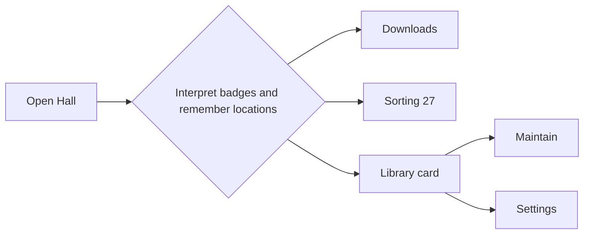
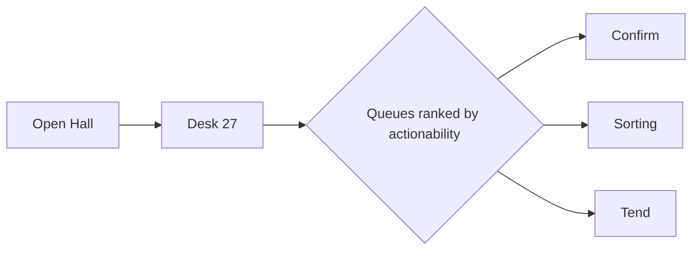
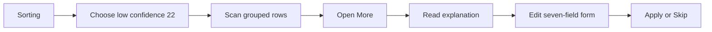
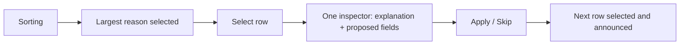

# 02 · Director of UX — Librarian — run 2026-11-04

**Reviewed:** Automat `http://10.10.1.202:8793` · image **1.0.10 / 480eff0** · owner session · Lights Down
**Evidence base:** live Hall/Search/Sorting accessibility snapshots; `frontend/src/components/AppChrome.jsx`; `frontend/src/pages/ReviewPage.jsx`; `frontend/src/components/HoldSlipCard.jsx`; `frontend/src/components/TypeaheadField.jsx`; [platform map](00_2026-11-04_platform-map.md).
**Companion files:** [platform map](00_2026-11-04_platform-map.md) · [run status and handoff](_status.md)
**Independence:** no other department conclusion was used. **Grade: B.**

# Part A — Conclusions & findings

## 1. Bottom line

Librarian has a coherent reader journey: Hall makes owned media primary, Search opens a quiet door to discovery, and a work can be peeked before the person commits to a full page. The owner journey is less coherent: Downloads, Sorting, Maintain, Settings, and People are individually capable but distributed across top navigation and the Library card, so a new owner must remember where each kind of work lives (UX-001, UX-011). The most important fix is to make one **Desk** entry the stable front door for owner/op work while preserving separate routes and the safety boundary between “Asked” and SAB (UX-001). The most important pattern to protect is Sorting’s reason-first triage—counts, grouped slips, one recommended action, and progressive disclosure—which turns a mixed backlog into understandable work (UX-002, UX-003). Grade **B**: strong task language and unusually good recovery detail, held back by owner IA, high control density, and unproven mobile/assistive parity.

## 2. Key conclusions

1. **The reader mental model is already the right one: enter the Hall, search owned shelves, then go beyond only when needed.** Hall, Stacks, Search, Favorites, Wanted, and work detail describe reader jobs instead of system internals. `AppChrome.jsx:84-107` keeps those peers together, while the platform map confirms Search’s local-first contract. Preserve this sequence; roadmap work should reduce owner noise around it, not replace Hall with metrics or acquisition status (UX-004, UX-012).

2. **Owner work has good tools but no single orientation point.** Desktop places Downloads and Sorting beside reader destinations (`AppChrome.jsx:109-118`), while Maintain, Settings, and People are inside the Library card (`ProfileMenu.jsx:164-191`). That split reflects implementation history, not the owner’s “what needs me today?” job. A Desk disclosure should group links and counts without merging the underlying workflows or weakening confirm-before-SAB (UX-001).

3. **Sorting’s reason-first model is the best owner interaction in the product.** The live desk exposed All 27, low confidence 22, Audnexus unmatched 2, unknown identity 2, and missing folder 1 before any individual form. Code sorts counts descending and reloads by reason (`ReviewPage.jsx:780-838`), then groups slips under named headings (`ReviewPage.jsx:1031-1054`). This is recognition rather than recall and should become the pattern for Downloads and Maintain attention queues (UX-002).

4. **A compact slip is good progressive disclosure; the expanded slip is still too expensive for repeated work.** Each collapsed row gives title, a four-word reason, and one recommended action (`HoldSlipCard.jsx:57-82`). “More” reveals explanation, recovery actions, seven metadata fields, and Apply/Skip (`HoldSlipCard.jsx:83-450`). That is safer than showing every field by default, but the live accessibility tree still contained 633 interactive controls for 27 slips, so the next step is a focused inspector or one-expanded-slip rule, not more inline controls (UX-003, UX-005).

5. **The product communicates system state well in several high-risk moments.** Sorting uses `aria-busy`, named progress meters, warm loading copy, an empty lamp, status notes, and an Undo action (`ReviewPage.jsx:852-1029`). Confirm-before-SAB and role-specific Ask/Get language prevent an accidental reader request from becoming an immediate download. Protect those delays and acknowledgements even when owner speed is improved (UX-009, UX-012).

6. **Search mechanics are accessible and flexible, but result labels can expose catalog debris.** `TypeaheadField.jsx:80-157` implements a debounced combobox, arrow navigation, active descendant, Escape dismissal, and Enter selection. The live Hall list contained filename-like variants such as “(Born 1) - Born In Fire” beside clean titles. Ranking and display normalization should happen before adding more suggestion sources (UX-004, UX-010).

7. **Mobile parity is asserted by code and e2e, but not proven against the live 10k-item household.** The mobile bar deliberately reduces navigation to Hall, Search, Favorites, Desk, and You (`AppChrome.jsx:136-158`), and mocked axe visits Hall and Sorting at 320px (`e2e/axe.spec.ts:355-369`). This pass did not obtain a live 390px visual capture; density, sticky actions, and horizontal overflow therefore remain Suspected, not “passed” (UX-007).

8. **Preferences are split by implementation boundary rather than person intent.** Theme and text size are immediate Library card controls, personal/security items live on `/card`, notifications have two destinations, and owner configuration is `/settings` (`ProfileMenu.jsx:110-191`). The proposed structure keeps these capabilities but groups them as You, Reading, Notifications, Household, Services, and Accessibility so people can predict where a control lives (UX-008, UX-011).

## 3. Foundations challenged

| Assumption | Evidence for | Evidence against | Verdict | Cost of change | Rationale |
|---|---|---|---|---|---|
| Hall is the universal home | Reader jobs and live rails begin there; `/` shortcut focuses search | Owners arrive with 27 Sorting slips and ~80 queue jobs | **Keep** | — | A household library should open as a library. Give owners a Desk badge/link, not an operations dashboard as home (UX-001, UX-012). |
| Downloads and Sorting deserve top-level peers | Different safety states: confirm Asked vs identify/organize failures | They compete with reader destinations and do not include Maintain | **Change grouping** | M | One Desk parent reduces recall while routes remain distinct. Do not merge job semantics (UX-001). |
| Confirm before SAB is acceptable friction | Prevents unintended acquisition; reader can only Ask | Adds an owner click | **Keep** | — | Safety and household cost outweigh one confirmation. Optimize batching, never silent grabs (UX-009). |
| Sorting should render many slips inline | Owners can scan and use j/k/x | 633 interactive controls in the live tree; repeated field sets | **Change** | M | Keep grouped rows; render one active inspector or one expanded slip (UX-003, UX-005). |
| Quiet hours belong on Sorting | Directly affects unpack/convert handling | It is configuration, not triage; adds controls before the backlog | **Move summary** | S | Show status + Settings link on Desk; edit schedule in Settings (UX-011). |
| Peek before full work page | Fast context without route change | Adds a choice before detail | **Keep** | — | Progressive detail fits browsing; the full page remains available (UX-012). |
| Library card can hold both preferences and admin links | One compact menu; role filtering works | Personal identity, theme, Maintain, Settings, People, Sorting, Downloads are mixed | **Change structure** | M | Keep the trigger, separate “Your library” from “Household desk” (UX-008). |
| Filename-like catalog titles are acceptable in typeahead | They reflect indexed truth | They undermine confidence and create duplicate-looking options | **Change display** | S | Normalize presentation while preserving raw paths in owner detail (UX-010). |
| `/review` may remain the URL for Sorting | Stable route and tests | “Review” leaks only in code, not the visible lexicon | **Keep** | — | A route migration has no user value; visible wording is correct. |
| Desktop-first owner work is sufficient | Established owners likely use desktop | Mobile Desk exists and owners may triage from a tablet | **Investigate** | M | Keep dense desktop; prove a one-column tablet/mobile inspector before claiming parity (UX-007). |

## 4. If we built it today

The reader product would still open in Hall. Desktop navigation would be **Hall · Stacks · Search · Favorites · Wanted**, followed by **Desk** only for owner/op, then Inbox and Library card. Desk would be an overview—not a new workflow—with three task queues: Confirm downloads, Sort slips, Tend library. Each queue would name the job, actionable count, last successful run, and one “Open” link. The existing `/queue`, `/review`, and `/maintain` routes would remain because they have distinct state machines.

Sorting would use a master-detail pattern. The left/top pane would contain grouped, virtualized rows: title, four-word reason, recommended action, status. Selecting a row would open one inspector with the explanatory “what this means / what we tried / what to do” copy and metadata fields. Group actions would remain at group level. Keyboard j/k would change the selected row, x would expand explanation, Enter would run only the clearly named recommended action after any required confirmation.

The gap is moderate and worth closing. The hard parts—reason classification, safe actions, status feedback, routes, and vocabulary—already exist. The change is information architecture plus rendering discipline, not a backend rewrite. Avoid a big-bang owner dashboard: introduce Desk as a link group, then the overview, then the single-inspector Sorting layout.

## 5. Findings by surface

**Public.** Login, join, and reset are intentionally small because this is invite-only household software, not a marketing funnel. The foyer uses named fields, invite paste, and direct “Enter” language; no public signup or pricing is missing for this product. The open question is recovery guidance when a household URL or invite is wrong, not acquisition conversion. **Grade A-.** IDs: UX-009.

**Consumer.** Hall/Search/work progression is the strongest surface. The global `/` shortcut, local-first Search, kind toggles, favorites, Wanted, and peek/full-detail split support both returning and power readers. The main debt is suggestion quality and empty shelf activation, not navigation. **Grade A-.** IDs: UX-004, UX-006, UX-010, UX-012.

**Owner.** Sorting shows excellent domain design, but owner destinations are fragmented and the live backlog produces an extreme number of controls. Destructive/bulk actions, quiet-hours configuration, group actions, and per-slip forms compete before the person has chosen a task. Desk grouping and one-active-slip rendering are the top priorities. **Grade B-.** IDs: UX-001, UX-002, UX-003, UX-005, UX-011.

**Admin.** There is no separate platform-admin or support console; owner Settings, People, Maintain, Downloads, and Sorting are the administration surface. That is appropriate for a single household, but the lack of one admin orientation page raises setup and maintenance costs. **Grade B.** IDs: UX-001, UX-008, UX-011.

## 6. Findings by theme

**Information architecture and navigation.** Reader IA is concrete and stable. Owner IA is location-based (“which page owns this setting?”), forcing recall. Direction: one Desk entry with route-preserving children; one clearly grouped Library card (UX-001, UX-008).

**Journeys and onboarding.** Returning reading is two to three decisions; first-owner setup crosses Settings, scan/maintain, Search, Downloads, and Sorting with no progress model. Direction: a first-library checklist that disappears after success and reappears only from Help (UX-008).

**Search, filters, and sorting.** Reason chips and kind chips work because they expose the current universe and counts. Typeahead fails when labels reproduce file names. Direction: normalize display labels, preserve raw source only in owner diagnostics (UX-002, UX-004, UX-010).

**Forms and error recovery.** Sorting’s field labels, help controls, status notes, and undo are strong. Repeating seven fields for every expanded slip raises visual and cognitive load. Direction: one inspector, preserve drafts when selection changes, announce unsaved changes (UX-003, UX-005).

**States and feedback.** WarmLoad, `aria-busy`, progress meters, empty lamps, Undo, and confirm dialogs provide unusually good visibility. Keep the truthful vocabulary—Asked, On the way, Arrived, Needs you, Failed—and never overload “Finished” for download status (UX-009, UX-012).

**Responsive and power use.** Mobile nav is intentionally reduced; owner keyboard shortcuts are valuable. Neither should become a hidden second product. Direction: same information hierarchy at every viewport, sticky selected-slip action on narrow screens, shortcuts documented in Help (UX-003, UX-007).

## 7. Stop doing

- Stop adding owner destinations directly to the top bar; route them through Desk (UX-001).
- Stop rendering every expanded slip’s full form in the accessibility tree at once (UX-003, UX-005).
- Stop editing Quiet hours in the triage flow; show status there and configure it in Settings (UX-011).
- Stop showing raw filename conventions as primary suggestion labels (UX-010).
- Stop treating mocked 320px axe coverage as proof of live mobile usability (UX-007).
- Stop adding preferences to whichever page already has room; follow the proposed settings tree (UX-008).

## 8. Strengths worth protecting

- Reason-first Sorting filters and grouped headings (UX-002).
- One-line slip + explanatory disclosure + recommended motion (UX-003).
- Hall hero search, rails, and peek-to-work progression (UX-004, UX-012).
- Confirm-before-SAB and role-safe Ask/Get language (UX-009).
- Skip link, `/` shortcut, j/k/x, Escape dismissal, and Undo (UX-003, UX-012).
- Lights Up/Down and text-size controls exposed as immediate personal preferences (UX-008).

## 9. Risks of inaction

Within 6–12 months, every new owner capability will add another destination or panel, turning a household library into an operations console. A larger Sorting backlog will make the current all-controls DOM slower for keyboard and assistive-technology users, and owners will avoid the desk until the count becomes intimidating. Filename-like suggestion labels will erode trust in catalog quality. Mobile support will remain nominal—tests exist, but maintainers will hesitate to use it for real triage. Most importantly, the excellent safety model will be blamed for slowness when the real problem is orientation and density.

## 10. Recommended direction

**Now (0–2 weeks):** preserve reason chips; move Quiet hours editing to Settings; improve purge confirmation; document `/` and j/k/x; normalize typeahead labels. **Next (2–6 weeks):** ship Desk as one owner navigation group and overview; add first-library checklist; enforce one expanded Sorting inspector. **Later (6+ weeks):** virtualize/group-window large backlogs and complete live mobile/tablet task tests.

In 90 days, an established owner should reach any actionable queue from one Desk entry, identify the largest problem group without scrolling, and complete ten low-confidence slips without repeatedly opening seven-field forms. Targets: 30% fewer owner-nav choices, fewer than 100 focusable controls at initial Sorting load, median low-confidence slip handling under 20 seconds, and 90% first-attempt success in a five-person owner findability test.

## 11. Scorecard

| Surface | IA | Task efficiency | Feedback & trust | Error recovery | Responsive | Overall |
|---|---:|---:|---:|---:|---:|---:|
| Public | 4 | 4 | 4 | 4 | 4 | **4.0** — small, direct invite foyer |
| Consumer | 5 | 4 | 4 | 4 | 3 | **4.0** — strong library journey; mobile visual unproven |
| Owner | 3 | 3 | 4 | 4 | 2 | **3.2** — excellent Sorting model, too many destinations/controls |
| Admin | 3 | 3 | 4 | 4 | 2 | **3.2** — capable single-household tools, weak orientation |

## Navigation trees

**Reader — current**
- Hall
- Stacks
- Search
- Favorites
- Wanted
- Inbox
- Library card
  - Your library
  - Notifications
  - Help

**Reader — proposed**
- Hall
- Stacks
- Search
- Favorites
- Wanted
- Inbox
- Library card
  - You: identity, password, sessions
  - Reading: theme, text size, reader defaults
  - Notifications
  - Help

**Owner/op — current**
- Hall · Stacks · Search · Favorites · Wanted
- Downloads
- Sorting + count
- Inbox
- Library card
  - Your library · Notifications · Help
  - Maintain · Settings · People · Sorting · Downloads

**Owner/op — proposed**
- Hall · Stacks · Search · Favorites · Wanted
- Desk + actionable count
  - Confirm downloads
  - Sort slips
  - Tend library (owner)
  - People (owner/op)
- Inbox
- Library card
  - You · Reading · Notifications · Accessibility · Services (owner) · Help

## Journey before/after

**Established owner: decide what needs attention**

Current: 2–4 clicks, 3–5 location decisions, grade 3/5. Proposed: 2 clicks, one queue decision, grade 5/5.

**Sort a low-confidence slip**

Current: 4–7 interactions and repeated form scanning, grade 3/5. Proposed: 3–4 interactions, stable inspector, grade 5/5.

# Part B — Detailed findings

## 12. Scope & method

Live read-only walkthrough covered owner Hall, Search, and Sorting at Automat. The Sorting snapshot on 2026-11-04/05 contained 1,021 accessibility refs and 633 interactive refs; screenshot capture timed out, so no pixel claims are made. Code inspection covered chrome, profile menu, typeahead, Sorting orchestration, slip composition, settings, and mocked axe routes. Not completed: reader-role session, destructive action execution, first-owner setup, 390px live screenshot, VoiceOver/NVDA, offline state, or a live axe run. Findings with those dependencies are Likely/Suspected.

## 13. Strengths

### UX-002: Preserve reason-first Sorting triage

| Field | Value |
|---|---|
| Type | Strength |
| Surface | Owner |
| Persona(s) | Established owner, op |
| Category | Search/filtering; Nielsen #6 recognition |
| Severity | High |
| Impact | 5 |
| Effort | S |
| Confidence | Confirmed |
| Priority score | 7.5 |
| Verdict | Protect |
| Dependencies | none |
| Labels | sorting, filters, owner-efficiency |

**Evidence:** Live `/review`: All 27, low confidence 22, Audnexus unmatched 2, unknown identity 2, missing folder 1. `frontend/src/pages/ReviewPage.jsx:780-838` sorts counts descending and reloads by reason; `:1031-1054` renders labelled groups.

**Current state:** The owner sees the shape of the backlog before individual records and can reduce it by cause. **Root cause:** the desk models reasons as first-class data rather than a decorative status.

**Recommendation:** Preserve counts, descending order, human labels, and grouped headings. Add persisted last filter only after an explicit test shows it does not hide new high-risk groups.

**Rationale:** It converts an incident pile into batches. A generic search box was rejected because the owner does not know which terms reveal systemic failures. Protect now because Desk and visual consolidation could accidentally flatten the groups.

**User story:** As an owner, I want slips grouped by why they need me so I can fix one class of problem at a time.

**Acceptance criteria:**
- [ ] Every non-zero reason has a named count and matching heading.
- [ ] Filter selection updates the list and announced count.
- [ ] “All” always restores the full backlog.

**Success metric:** 90% of owners choose a reason group before opening a slip.

**Validation:** Seed five reasons; compare chip counts, headings, and API totals.

### UX-003: Preserve compact slips and recommended motion

| Field | Value |
|---|---|
| Type | Strength |
| Surface | Owner |
| Persona(s) | Established owner, keyboard-only owner |
| Category | Progressive disclosure; Nielsen #7 flexibility |
| Severity | Medium |
| Impact | 4 |
| Effort | S |
| Confidence | Confirmed |
| Priority score | 4.0 |
| Verdict | Protect |
| Dependencies | UX-005 |
| Labels | sorting, shortcuts, progressive-disclosure |

**Evidence:** `frontend/src/components/HoldSlipCard.jsx:57-82` exposes title, four-word reason, and one recommended button; `:83-148` puts explanation under More. `ReviewPage.jsx:784-808` provides j/k/x; live control label names the shortcuts.

**Current state:** Fast decisions remain fast, while unusual cases can expose detail. **Root cause:** action recommendation and explanation are separated from raw metadata.

**Recommendation:** Keep the collapsed contract and shortcuts during a master-detail migration. Document `/`, j/k/x, Escape, and Enter in Help and an optional shortcut overlay.

**Rationale:** Expanding every form would be slower; hiding explanation would be unsafe. Protect now because UX-005 changes rendering and could erase the compact row.

**User story:** As an op, I want the likely next action visible without losing access to the diagnosis.

**Acceptance criteria:**
- [ ] Collapsed row contains title, reason, one primary action.
- [ ] j/k changes active slip; x toggles explanation.
- [ ] Shortcuts never fire while typing.

**Success metric:** Ten clear slips completed in under three minutes without pointer input.

**Validation:** Keyboard-only seeded Sorting test.

### UX-004: Preserve local-first Search and semantic typeahead

| Field | Value |
|---|---|
| Type | Strength |
| Surface | Consumer |
| Persona(s) | Returning reader, power reader |
| Category | Search; Nielsen #2 match to real world |
| Severity | High |
| Impact | 5 |
| Effort | S |
| Confidence | Confirmed |
| Priority score | 7.5 |
| Verdict | Protect |
| Dependencies | UX-010 |
| Labels | search, hall, combobox |

**Evidence:** Live Hall/Search; `frontend/src/components/TypeaheadField.jsx:80-157` implements combobox/listbox semantics, arrows, Escape, and Enter. Platform map documents owned shelves first and Beyond as a quiet door.

**Current state:** Search begins with what the household owns and expands without turning Hall into a download client. **Root cause:** acquisition is a fallback, not the primary content model.

**Recommendation:** Keep the hierarchy and interaction semantics. Improve suggestion labels under UX-010; do not add external hits into Hall typeahead.

**Rationale:** Unified external/local results would appear powerful but blur ownership and safety. Protect now as new providers are added.

**User story:** As a reader, I want shelf results first so I can open what we already own.

**Acceptance criteria:**
- [ ] Hall suggestions contain catalog items only.
- [ ] Arrow/Escape/Enter behavior remains covered.
- [ ] Beyond remains clearly labelled and role-safe.

**Success metric:** Owned-item search-to-open median remains under 15 seconds.

**Validation:** Component test plus reader-role e2e.

### UX-009: Preserve confirmation and truthful job states

| Field | Value |
|---|---|
| Type | Strength |
| Surface | Consumer, Owner |
| Persona(s) | Reader, owner, op |
| Category | Feedback/trust; Nielsen #5 error prevention |
| Severity | High |
| Impact | 5 |
| Effort | S |
| Confidence | Confirmed |
| Priority score | 7.5 |
| Verdict | Protect |
| Dependencies | none |
| Labels | trust, downloads, status |

**Evidence:** Platform map: reader Ask does not call SAB; Downloads confirms Asked. `e2e/axe.spec.ts:253-266` opens “Send to the downloader?”; `ReviewPage.jsx:852-875` exposes Undo and `:949-1010` named progress meters.

**Current state:** Irreversible/external work requires the right role and confirmation; background work reports progress. **Root cause:** job vocabulary and safety boundaries are explicit.

**Recommendation:** Preserve confirm-before-SAB, Undo where technically possible, and the five job words. Batch confirmation may reduce clicks but must list count and consequences.

**Rationale:** Silent acquisition was rejected because wrong media costs bandwidth and owner cleanup. Protect now while Desk work seeks speed.

**User story:** As an owner, I want to know exactly what will be sent or changed before it happens.

**Acceptance criteria:**
- [ ] Reader Ask cannot directly queue SAB.
- [ ] Confirm names action and item/count.
- [ ] Progress and terminal state are visible and announced.

**Success metric:** Zero accidental-download reports; 100% external jobs have a visible terminal state.

**Validation:** Reader/owner role e2e and job-state fixtures.

### UX-012: Preserve Hall’s reading-room progression

| Field | Value |
|---|---|
| Type | Strength |
| Surface | Consumer |
| Persona(s) | Returning reader, low-bandwidth reader |
| Category | Journey; Nielsen #8 minimalist design |
| Severity | High |
| Impact | 5 |
| Effort | S |
| Confidence | Confirmed |
| Priority score | 7.5 |
| Verdict | Protect |
| Dependencies | none |
| Labels | hall, peek, rails |

**Evidence:** Live `/`: Search, kind counts, Continue, Recently added, Favorites, New & noted. Platform map confirms peek then `/works/:id`; `AppChrome.jsx:84-107` keeps reader destinations first.

**Current state:** The home page supports resumption and discovery without owner telemetry. **Root cause:** the product treats owned media, not download machinery, as the primary object.

**Recommendation:** Keep hero search, Continue above novelty, and peek before full detail. Never replace Hall with a dashboard.

**Rationale:** A KPI home would help the owner and harm every reader. Desk provides the owner alternative. Protect now because backlog counts create pressure to promote operations.

**User story:** As a reader, I want to continue or find a work without seeing maintenance chores.

**Acceptance criteria:**
- [ ] Hall’s first viewport contains Search and reader rails, not ops tiles.
- [ ] Continue remains before Recently added when non-empty.
- [ ] Peek offers a clear full-detail path.

**Success metric:** Returning reader resumes in two interactions or fewer.

**Validation:** Desktop/mobile reader e2e with progress fixture.

## 14. Weaknesses

### UX-005: Reduce destructive and repeated controls on Sorting

| Field | Value |
|---|---|
| Type | Weakness |
| Surface | Owner |
| Persona(s) | Established owner, keyboard-only owner |
| Category | Error prevention; cognitive load |
| Severity | High |
| Impact | 5 |
| Effort | M |
| Confidence | Confirmed |
| Priority score | 5.0 |
| Verdict | Fix |
| Dependencies | UX-002, UX-003 |
| Labels | sorting, destructive, density |

**Evidence:** Live `/review` exposed 633 interactive refs for 27 slips, including Purge duplicates (27), group deletes, repeated More/help buttons, and repeated seven-field forms. `HoldSlipCard.jsx:350-445` renders every expanded identify form.

**Current state:** Progressive disclosure exists visually, but many nested controls remain in one document and bulk actions compete near filters. **Root cause:** each slip owns a complete editor and action set.

**Recommendation:** Render one selected inspector; virtualize/window rows only after semantic grouping tests. Place bulk destructive actions in a “Desk actions” disclosure and require a typed count for purge/group deletion when count >1.

**Rationale:** Pagination alone was rejected because it fragments reason batches; hiding controls with CSS was rejected because DOM/AT cost remains. Fix now before backlog growth multiplies the problem.

**User story:** As an owner, I want one clear editing context so I do not apply or delete the wrong slip.

**Acceptance criteria:**
- [ ] Initial Sorting has fewer than 100 focusable controls with 27 slips.
- [ ] Exactly one slip inspector is mounted.
- [ ] Purge/delete confirmation names count and scope.
- [ ] Selection and unsaved edits survive filter changes or block with a warning.

**Success metric:** 50% reduction in initial interactive nodes and zero wrong-scope deletes in usability testing.

**Validation:** accessibility-tree count, keyboard walk, destructive-action e2e.

### UX-001: Group owner work under one Desk entry

| Field | Value |
|---|---|
| Type | Weakness |
| Surface | Owner, Admin |
| Persona(s) | New owner, established owner, op |
| Category | Navigation; Nielsen #6 recognition |
| Severity | High |
| Impact | 4 |
| Effort | M |
| Confidence | Confirmed |
| Priority score | 4.0 |
| Verdict | Rethink |
| Dependencies | **BD-2** |
| Labels | owner-ia, navigation, decision-required |

**Evidence:** `frontend/src/components/AppChrome.jsx:109-118` puts Downloads and Sorting in primary nav; `ProfileMenu.jsx:164-191` puts Maintain, Settings, People, Sorting, and Downloads in the Library card. Live top bar shows both operations peers and Sorting 27.

**Current state:** Tools are discoverable only if the owner knows whether they are daily work, configuration, or personal preference. **Root cause:** route ownership became navigation structure.

**Recommendation:** Pending **BD-2**, make one Desk entry for owner/op. Its overview links Confirm, Sorting, Tend, and People; Settings stays in Services/Library card. Keep routes and direct deep links.

**Rationale:** A permanent side rail was rejected as too heavy for readers; merging routes was rejected because jobs differ. Leadership must decide whether Desk becomes a durable product concept, so `DecisionRequired=yes`. Decide now before more owner surfaces harden the current split.

**User story:** As an owner, I want one place that tells me what needs attention so I do not memorize five destinations.

**Acceptance criteria:**
- [ ] Desktop has at most one owner-work peer.
- [ ] Desk lists actionable counts by workflow.
- [ ] Readers never see Desk.
- [ ] Direct `/queue`, `/review`, `/maintain`, `/people` links remain valid.

**Success metric:** New owners find Sorting, Downloads, and Maintain in under 20 seconds each.

**Validation:** five-person tree test and owner/op/reader route e2e.

### UX-010: Normalize typeahead labels before display

| Field | Value |
|---|---|
| Type | Weakness |
| Surface | Consumer |
| Persona(s) | Returning reader, non-native-language user |
| Category | Search; Nielsen #2 match to real world |
| Severity | Medium |
| Impact | 3 |
| Effort | S |
| Confidence | Confirmed |
| Priority score | 3.0 |
| Verdict | Fix |
| Dependencies | UX-004 |
| Labels | search, content-quality |

**Evidence:** Live Hall suggestions included “(Born 1) - Born In Fire” and “Born In Fire (2398)” with a generic “shelf” meta label. `TypeaheadField.jsx:140-157` prints `item.value` verbatim.

**Current state:** Interaction is sound, but primary labels sometimes resemble filenames or IDs. **Root cause:** suggestion value doubles as display label and query value.

**Recommendation:** Return separate `value`, `label`, `secondary`, and `kind`; display “Title · Author” with kind, retain canonical value for selection. Deduplicate normalized title/author pairs.

**Rationale:** Client regex cleanup was rejected because it can corrupt legitimate titles. Fix now because every new catalog increases duplicate/noisy suggestions.

**User story:** As a reader, I want suggestions to look like books, not storage paths.

**Acceptance criteria:**
- [ ] No filename punctuation or internal ID is shown unless part of canonical metadata.
- [ ] Duplicate normalized title/author options collapse.
- [ ] Screen-reader name includes title, author, and kind.

**Success metric:** Fewer than 2% of sampled top-10 suggestions require owner interpretation.

**Validation:** hostile fixture titles plus live sample audit.

### UX-011: Remove configuration from the triage path

| Field | Value |
|---|---|
| Type | Weakness |
| Surface | Owner |
| Persona(s) | Established owner, op |
| Category | Minimalism; Nielsen #8 |
| Severity | Medium |
| Impact | 3 |
| Effort | S |
| Confidence | Confirmed |
| Priority score | 3.0 |
| Verdict | Fix |
| Dependencies | UX-001 |
| Labels | sorting, settings, quiet-hours |

**Evidence:** `ReviewPage.jsx:881-917` places Quiet hours schedule editing before bulk actions and slips. The same concept has a Settings section at `SettingsPage.jsx:452`.

**Current state:** A daily triage screen contains schedule configuration. **Root cause:** the team colocated a setting with the failures it can create.

**Recommendation:** Sorting shows one status sentence (“Quiet hours active until 07:00”) and a Settings link. All edits live in Settings; owner only if role policy requires it.

**Rationale:** Removing status was rejected because it explains deferred work. Duplicating controls was rejected because values can drift. Fix now as a low-risk density reduction.

**User story:** As an op, I want to understand why work waits without editing household automation by accident.

**Acceptance criteria:**
- [ ] Sorting contains no schedule text inputs.
- [ ] Current quiet-hours state and end time remain visible.
- [ ] Link opens the exact Settings section.

**Success metric:** Four controls removed from initial Sorting focus order.

**Validation:** role-aware Sorting/Settings e2e.

### UX-006: Give empty named shelves an activation path

| Field | Value |
|---|---|
| Type | Weakness |
| Surface | Consumer |
| Persona(s) | Returning reader, power reader |
| Category | Empty states; Nielsen #1 visibility |
| Severity | Medium |
| Impact | 3 |
| Effort | S |
| Confidence | Likely |
| Priority score | 2.4 |
| Verdict | Fix |
| Dependencies | none |
| Labels | shelves, empty-state |

**Evidence:** Platform map reports zero named shelves while Hall/Favorites exist; current live pass did not create a shelf. Shelf model exists in the data map and browse routes.

**Current state:** Named shelves are supported but their zero-state activation was not visible on Hall. **Root cause:** presence is optimized for populated rails.

**Recommendation:** In the shelf section, show “Make a shelf for a mood, person, or project” with Create shelf; do not render an empty horizontal rail.

**Rationale:** A global onboarding modal was rejected as intrusive. Add inline guidance now because empty-state copy is cheap and shelves support retention.

**User story:** As a reader, I want to create my first shelf where shelves would appear.

**Acceptance criteria:**
- [ ] Zero named shelves shows one explanation and Create shelf.
- [ ] Created shelf replaces the empty state without reload.

**Success metric:** 25% of active households create one named shelf within 30 days.

**Validation:** zero/one/many shelf fixtures.

### UX-007: Prove mobile owner parity on live-scale data

| Field | Value |
|---|---|
| Type | Weakness |
| Surface | Cross-cutting |
| Persona(s) | Low-bandwidth mobile user, tablet owner |
| Category | Responsive behavior |
| Severity | Medium |
| Impact | 3 |
| Effort | M |
| Confidence | Suspected |
| Priority score | 1.0 |
| Verdict | Fix |
| Dependencies | UX-005 |
| Labels | mobile, qa, suspected |

**Evidence:** `AppChrome.jsx:136-158` defines a reduced mobile tab bar; `e2e/axe.spec.ts:355-369` checks Hall/Sorting at 320px. Live screenshot capture failed and no 390px task was completed.

**Current state:** Structural tests exist; usability with 27 real slips and long paths is unknown. **Root cause:** mocked viewport checks are treated as responsive completion.

**Recommendation:** Add authored 320/390/768 task tests for Hall search, Ask, Sorting selection, and Apply/Skip; verify 200% zoom and long strings.

**Rationale:** A separate mobile UI was rejected because it doubles behavior. Validate the responsive system now before master-detail work ships.

**User story:** As an owner on a tablet, I want to resolve one slip without horizontal scrolling or hidden actions.

**Acceptance criteria:**
- [ ] No two-axis page scroll at 320px.
- [ ] Selected-slip action remains visible at 390px and 200% zoom.
- [ ] Long paths wrap without covering controls.

**Success metric:** 100% completion of four authored tasks at three widths.

**Validation:** Playwright layout assertions plus live visual QA.

## 15. Opportunities

### UX-008: Regroup settings by person intent

| Field | Value |
|---|---|
| Type | Opportunity |
| Surface | Consumer, Owner |
| Persona(s) | Reader, owner, low-vision user |
| Category | Settings; Nielsen #6 recognition |
| Severity | Medium |
| Impact | 3 |
| Effort | M |
| Confidence | Confirmed |
| Priority score | 2.0 |
| Verdict | Add |
| Dependencies | UX-001 |
| Labels | settings, preferences, ia |

**Evidence:** `ProfileMenu.jsx:110-191` mixes Theme, Text size, personal links, owner tools, and Logout; platform map lists `/card`, `/notifications`, `/settings`, `/people`, `/maintain`.

**Current state:** Every capability has a home, but the homes do not form a predictable model. **Root cause:** preferences grew by route.

**Recommendation:** Use: **You** (identity, password, sessions); **Reading** (theme, text size, reader defaults); **Notifications**; **Accessibility** (motion, contrast preference only if needed); **Household** (people/invites); **Services** (paths, indexers, SAB, LLM, mail); **Help**. Keep theme/text size quick controls in the card.

**Rationale:** One mega-page was rejected; route-per-control was rejected. Group now while the surface is still small.

**User story:** As a household member, I want settings grouped by my goal so I can predict where a control lives.

**Acceptance criteria:**
- [ ] Every existing preference maps to exactly one group.
- [ ] No duplicated save control.
- [ ] Role-hidden groups are absent, not disabled.

**Success metric:** 80% first-click success in a settings tree test.

**Validation:** card sort, route tests, reader/owner screenshots.

## 16. Remediation plan

| Horizon | ID | Title | Effort | Owner role | Dependencies |
|---|---|---|---|---|---|
| Now | UX-005 | Reduce destructive/repeated Sorting controls | M | Product + frontend | UX-002, UX-003 |
| Now | UX-010 | Normalize typeahead labels | S | Backend + frontend | UX-004 |
| Now | UX-011 | Move Quiet hours editing | S | Frontend | UX-001 |
| Now | UX-003 | Document and preserve shortcuts | S | UX + frontend | UX-005 |
| Next | UX-001 | Group owner work under Desk | M | Product + frontend | BD-2 |
| Next | UX-006 | Named-shelf empty activation | S | Frontend | none |
| Next | UX-008 | Regroup settings | M | Product + frontend | UX-001 |
| Next | UX-007 | Mobile live-scale proof | M | QA + frontend | UX-005 |
| Later | UX-005 | Virtualized/master-detail backlog | M | Frontend | initial inspector |

Sequencing protects the safe action model first, removes easy density, then changes navigation after BD-2. Master-detail precedes virtualization because semantic focus behavior must be correct before rows are windowed.

## 17. Quick wins

- Move Quiet hours inputs to Settings and leave a status link (UX-011).
- Put `/` and j/k/x in Help (UX-003).
- Add count/scope language to destructive confirmation (UX-005).
- Split typeahead display label from selected value (UX-010).
- Add inline first-shelf CTA (UX-006).

## 18. Open questions

- **BD-2:** Is Desk a durable product concept and one desktop peer, or only a menu label? UX-001 remains `DecisionRequired=yes`.
- Should op users edit Quiet hours, or only observe status?
- Should Desk count sum all work, or show the highest-priority queue to avoid an anxiety badge?
- Which metadata edits must autosave as a draft when switching slips?
- What is the mobile owner’s real frequency: emergency correction, or routine triage?

## Phase 6 self-check

- [x] Part A includes all required sections, surfaces, scorecard, proposed trees, settings structure, and journey diagrams.
- [x] IDs UX-001 through UX-012 are preserved and unique.
- [x] Every finding uses the full ticket format with evidence, alternatives, and why now.
- [x] UX-001 remains dependent on BD-2.
- [x] Live limitations are explicit; no screenshot-only claim was invented.
- [x] No application code or sibling review file was modified.
