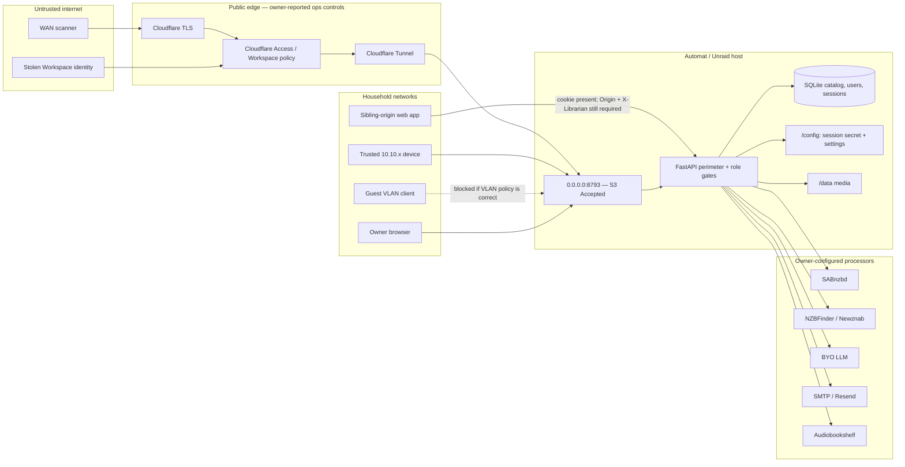

# 06 · Senior Security Team — Librarian 360° review, run 2026-11-04

**Review target:** Automat Librarian `1.0.10` / image revision `480eff0` on LAN `:8793`  
**Review mode:** evidence-led, review only; no exploit payloads, account mutation, secret access, or proof-of-concept code  
**Overall grade:** **B+**  
**Accepted Critical:** `0.0.0.0:8793` bind, recorded as S3 in `docs/SECURITY.md`  
**Companion files:** [platform/status handoff](_status.md) · [privacy review](07_2026-11-04_privacy-compliance.md) · [big decisions](31_2026-11-04_big-decisions.md) · [backlog](2026-11-04_backlog.csv)

---

# Part A — Conclusions & findings

## 1. Bottom line

Librarian earns a **B+** because the application perimeter is intentionally fail-closed, the public API is method-and-path enumerated, household authentication is mandatory from first boot, and unsafe browser mutations require both an allowed Origin and a non-simple `X-Librarian: 1` header. Those are unusually strong defaults for a small self-hosted household service, and they are reinforced by PBKDF2 password hashing, signed revocable sessions, route-level roles, CSP, sandboxed media responses, rate limits, disabled OpenAPI, and refusal of the public development session secret (SEC-001–SEC-004).

The grade cannot be an A while the container intentionally listens on **all interfaces at `0.0.0.0:8793`**. `docs/SECURITY.md` classifies that exposure as Critical and Accepted, and the current product path still depends on network segmentation and operator discipline rather than a shipped reverse-proxy-only distribution contract (SEC-006). The owner reports that `librarian.automat.vip` is protected by Cloudflare Access and TLS and that the guest network is a separate VLAN with only private routes to `10.10.x.x`; those are valuable defense-in-depth controls, but they are operational evidence, not a replacement for the accepted application bind and not independently verified Cloudflare-policy evidence.

The most important fix is therefore to make the exposure posture measurable and explicit now—verify direct-port firewalling, proxy trust, public Origin, Access policy, and tunnel routing—while leadership decides the eventual Hub reverse-proxy-only exit in [BD-1](31_2026-11-04_big-decisions.md#bd-1-hub-reverse-proxy-only-exit-vs-permanent-lan-bind) (SEC-006). The most important protections are the exact public handshake, the centralized session gate plus route roles, and the Origin/header mutation gate (SEC-001–SEC-003). Optional owner MFA remains a separate product/security decision under [BD-5](31_2026-11-04_big-decisions.md#bd-5-optional-owner-mfa), not a substitute for fixing network posture (SEC-009).

## 2. Key conclusions

1. **Librarian has a real application perimeter, not a UI-only login convention.** `create_app` rejects the public development secret, authenticates every non-handshake `/api` request, and attaches the server-resolved user to request state; individual routes then use `require_role` for owner/op/reader capability boundaries. The sampled People, Settings, session, notification, and owner status paths all enforce roles server-side. This deserves protection through route-inventory tests because one omitted role check on a new route would bypass the strongest architectural assumption (SEC-001).

2. **The anonymous surface is small, explicit, and mostly low-disclosure.** `docs/SECURITY.md:40-58` lists the exact handshake instead of exposing a permissive `/api/auth/*` prefix. Health is `{status:"ok"}`, readiness has an empty body, and operational status is owner-only. `/api/features` still returns the application version, household name, owner readiness, and auth method; this is intentional foyer functionality rather than a secret, but additions to that response require security review (SEC-002).

3. **Browser mutation defense correctly addresses same-site sibling applications.** SameSite=Lax alone does not stop every same-site or sibling-host request. Librarian requires an exact allowed Origin or Referer and `X-Librarian: 1` on every unsafe `/api` method, while the SPA deliberately supplies that header. This raises the bar above cookie-only CSRF protection and should not be weakened for alternate clients; non-browser clients should send both the explicit Origin and household header (SEC-003).

4. **Untrusted book content is treated as content, not an application extension.** The app CSP prohibits objects, foreign scripts, framing, and base-URI changes; direct download/stream responses receive a sandbox-only CSP. This does not prove every parser is memory-safe, but it meaningfully limits the browser blast radius of a hostile EPUB/PDF and preserves the original S19 mitigation (SEC-004).

5. **Secrets are masked at the API and permissioned on disk, but remain plaintext to the host.** Settings responses blank known secret values and expose only “set” metadata. The persisted JSON is chmod `0600`, and nightly database snapshots exclude `settings.json` and `session_secret`. Anyone who can mount or copy `/config`, inspect a separately copied settings file, or administer the Unraid host can still recover integration credentials. That is an explicit self-hosted trust boundary, not encryption at rest (SEC-005).

6. **Cloudflare Access and VLAN separation reduce likelihood, not severity, of the accepted bind.** TLS protects the public browser-to-edge path; Access can require Workspace identity before traffic reaches the tunnel; guest VLAN rules reduce direct LAN reachability. None of those controls changes the fact that the container accepts connections on every host interface, and none was verified here through Cloudflare configuration APIs or firewall exports. Direct `:8793`, a future NAT rule, a compromised trusted-LAN device, or proxy-trust misconfiguration remains outside Access (SEC-006).

7. **The public-Origin feature solves the correct compatibility problem without disabling CSRF checks.** `PUBLIC_BASE_URL` and `LIBRARIAN_PUBLIC_ORIGINS` add exact scheme/host/port tuples; they do not admit arbitrary Origins. With trusted proxy headers enabled, the app can derive the HTTPS public origin while still rejecting foreign sites. The security requirement is precise configuration: public URL must be `https://librarian.automat.vip`, extra Origins must remain minimal, and proxy trust must be enabled only on the proxy-backed container (SEC-007).

8. **Authentication assurance is proportionate for a LAN household but below the owner account’s impact.** Passwords use PBKDF2-SHA256 at 600,000 iterations, failed logins get per-IP and per-account controls, sessions are signed, database-backed, revocable, and invalidated on password changes. The owner session can nevertheless reach integration credentials, destructive maintenance, member administration, and SAB confirmation for 30 days without MFA or step-up. Optional TOTP or passkey support should follow an explicit decision and recovery design (SEC-009).

9. **Supply-chain confidence is currently process evidence, not a fresh audit result.** This pass did not run `pip-audit` or `npm audit`, did not inspect upstream advisories, and did not review GitHub Actions pinning. Existing lockfiles and tests help reproducibility but do not establish that dependencies were advisory-clean on 2026-11-04. The right response is a repeatable audit cadence with triage ownership, not an unsupported “no known vulnerabilities” claim (SEC-008).

## 3. Foundations challenged

| Assumption | Evidence for | Evidence against | Verdict | Cost of change | Rationale |
|---|---|---|---|---|---|
| A trusted household LAN is an adequate primary perimeter | Auth is always on; owner reports guest VLAN isolation; bare port is not intentionally WAN-published | Compromised trusted devices and routing mistakes still reach all-interface bind; S3 is Critical/Accepted | **Change** | M–L | Keep LAN access for operations, but make direct-port reachability a verified exception and decide the reverse-proxy-only exit (SEC-006). |
| Cloudflare Access makes the service private | Owner reports Workspace auth and TLS at `librarian.automat.vip`; Access can block anonymous internet traffic | Access covers only the Cloudflare route, not direct `:8793`; policy, bypass, session duration, and tunnel ingress were not independently inspected | **Investigate / verify** | S | Treat Access as a strong outer gate, document policy evidence, but never use it to waive app auth or direct-port controls. |
| TLS termination is enough for public safety | TLS protects credentials and cookies in transit; trusted proxy mode can set Secure cookies | TLS does not authorize users, validate Origin, or prevent direct HTTP LAN access | **Keep as one layer** | S | Preserve TLS, Access, application auth, and Origin checks as independent controls (SEC-003, SEC-006, SEC-007). |
| Role strings are sufficient authorization | Three roles fit a household; `require_role` is simple and widely used | New routes can choose the wrong role set; no generated capability inventory was reviewed | **Keep, test centrally** | M | Replacing roles is unnecessary; route-policy inventory and negative tests deliver more value (SEC-001). |
| SameSite cookies alone prevent CSRF | Lax blocks many cross-site form submissions | Same-site sibling apps and body-less mutations motivated S20 | **Reject** | XS | Keep Origin/Referer plus `X-Librarian` on every unsafe API call (SEC-003). |
| Plaintext secrets with `0600` are acceptable in self-hosting | Host already controls process and volumes; API masking and permissions reduce accidental disclosure | SMB copies, broad mounts, host admins, and manually copied backups can read values | **Keep with explicit boundary** | M | Encryption using a nearby key adds little against host compromise; ACL, backup, and rotation controls are the practical priority (SEC-005). |
| A 30-day owner session is acceptable | Household convenience; sessions are revocable and database-backed | A stolen owner browser retains broad control without step-up | **Investigate** | M | Consider shorter owner idle lifetime or step-up together with MFA and recovery, not as an isolated cookie tweak (SEC-009). |
| Local passwords are enough forever | Strong PBKDF2, account backoff, generic failure response, no public signup | No second factor for the highest-impact identity | **Change after decision** | L | Optional MFA is justified if remote Access remains a normal path; recovery and household operability require BD-5 (SEC-009). |
| Dependency lockfiles equal supply-chain assurance | Reproducible resolution and tests reduce accidental drift | Lockfiles preserve vulnerable versions too; this review ran no advisory audit | **Change** | S | Add scheduled and release-time audit evidence with an exception process (SEC-008). |
| Public version disclosure is harmless | Useful support signal in foyer; code intentionally returns version | Gives scanners a component-version hint | **Keep, monitor** | XS | The small information leak is acceptable for this product; do not add revision, proxy, backup, or integration posture to public features (SEC-002). |

## 4. If we built it today

A zero-based Librarian would preserve the current single-service architecture, household roles, SQLite state, and explicit public handshake. It would put a small TLS reverse proxy or tunnel connector in the supported deployment topology from day one, publish only that ingress to untrusted networks, and keep the application port reachable only from the proxy network plus a deliberately documented administrator path. The app would still authenticate every request because Cloudflare Access establishes perimeter identity, not Librarian role or object authorization.

The browser contract would remain almost exactly as implemented: HttpOnly/Secure/SameSite cookie, exact Origin allowlist, required non-simple request header, deny-by-default CSP, and separate sandbox policy for media bytes. A generated route manifest would list method, path, public/authenticated status, allowed roles, mutation class, rate limit, and audit event. CI would fail if a route were unclassified.

Secrets would remain local and operator-owned. Instead of adding cosmetic encryption whose key sits beside the ciphertext, the design would document the host trust boundary, prevent settings from entering routine database backups, mask values in APIs, record rotation dates, and offer a provider-by-provider revoke/replace checklist. Operators needing stronger host separation could inject secrets from a platform secret store.

The owner account would support optional TOTP or passkeys, recovery codes, and step-up for revealing/replacing integration credentials, deleting a member, or executing high-impact maintenance. This is a meaningful gap, but it is smaller than replacing the current auth stack. Closing the exposure verification, audit cadence, and optional-MFA gaps is worth it; replacing FastAPI, SQLite, local auth, or the role model is not.

## 5. Lightweight threat model

**Assets.** Owner credentials; signed session cookies and their HMAC secret; invite and reset capabilities; member identities, progress, shelves, whispers, notifications, and reading history; integration API keys; catalog and media files; SAB queue authority; security-event history; Cloudflare Access and tunnel configuration.

**Actors.** Anonymous internet scanner; credential-stuffing bot; malicious or compromised trusted-LAN device; guest client if segmentation fails; invited reader or operator exceeding their role; sibling-origin browser application; stolen owner session; malicious document; host administrator; compromised dependency or third-party integration.

**Trust boundaries.** Internet to Cloudflare edge; Access to tunnel; tunnel to the all-interface host port; LAN/VLAN routing to `:8793`; browser to FastAPI; authenticated reader/op to owner capability; app to `/config` and `/data`; app to SAB/indexers/LLM/mail; host and backup administrators to persisted data.

**Critical path.** The public edge lowers internet reachability, but the application’s accepted all-interface bind remains a separate boundary. The review therefore does not downgrade SEC-006 based on Access or VLAN claims.

## 6. Findings by surface

### Public

The public surface is intentionally sparse and method-specific. Health does not disclose version or revision; readiness discloses only ready/not-ready; login and invite routes are rate-limited; documentation endpoints are disabled. The foyer features response exposes only household name, owner readiness, local auth method, and version. This is strong perimeter engineering (SEC-002).

The public route through `librarian.automat.vip` is reported to have TLS and Workspace-gated Cloudflare Access. That improves public posture, but this review did not inspect Cloudflare account settings, policy selectors, bypass/service-token rules, Access session duration, tunnel ingress, or origin firewall rules. The direct LAN product port remains reachable according to network policy and the container bind (SEC-006, SEC-007). **Public grade: 4/5.**

### Consumer

Readers and operators receive the same authenticated session primitives as the owner and are server-gated by route role. Personal notifications are queried by `user["id"]`; People management and settings remain elevated. The Origin/header gate protects a signed-in reader from a sibling application attempting a state-changing request (SEC-001, SEC-003).

The main consumer security dependency is policy consistency: every future shelf, progress, whisper, notification, OPDS, and Ask route must keep actor scope in the database operation and must not infer authorization from UI visibility. No consumer-specific bypass was confirmed in this review. **Consumer grade: 4/5.**

### Owner

The owner receives broad and appropriate administrative capability: People role/reset/disable/delete, integration settings, maintenance, confirmation, and operational status. Password hashing, account backoff, session revocation, secret masking, and security-event writes provide a solid base (SEC-001, SEC-005).

That concentration makes owner assurance the remaining identity gap. A 30-day owner session with no MFA or action step-up is convenient but high impact if stolen. Cloudflare Access may add an outer identity challenge on the VIP, yet direct LAN login and an already-issued Librarian session remain independent. **Owner grade: 3/5** pending BD-5 (SEC-009).

### Admin / operations

The admin surface benefits from hidden API docs, owner-only status, non-root packaging documented in `docs/SECURITY.md`, 0600 settings/session files, and provider key rotation guidance. The Automat runbook explicitly warns against bare port forwarding and proxy trust outside a controlled TLS hop (SEC-005–SEC-007).

Operational controls are not yet represented as a repeatable evidence pack. A quarterly check should capture firewall/direct-port reachability, Access policy summary, tunnel ingress, proxy-trust state, public URL, dependency audits, backup permissions, and restore readiness without recording secrets. **Admin grade: 3/5.**

## 7. Findings by theme

**Authentication and sessions.** PBKDF2-SHA256 at 600,000 iterations, a 32-byte salt, constant-time comparison, generic login failures, signed 30-day tokens, session IDs in SQLite, revoke-all, epoch invalidation, and refused development secrets are strong. Missing optional MFA/step-up and long owner lifetime are the material gaps (SEC-009).

**Authorization and object access.** Authentication is centralized in middleware and roles are checked at routes. The sampled owner and member routes are explicit. The risk is regression by addition: `require_role` has many callers and no generated policy inventory was reviewed. Preserve server-side checks and add negative role tests for each route class (SEC-001).

**Browser and content isolation.** Origin/Referer plus `X-Librarian`, frame denial, no-sniff, no-referrer, permissions restrictions, COOP, CSP, and media sandboxing provide layered browser protection. Keep public Origins exact and never “fix” a proxy login by allowing `*` or skipping the household header (SEC-003, SEC-004, SEC-007).

**Secrets and host trust.** API masking and file permissions prevent common accidental leaks. The residual is deliberate: host and volume readers can recover plaintext integration keys. Restrict mounts and shares, omit settings from normal snapshots, and rotate provider-side first after suspected exposure (SEC-005).

**Transport and network exposure.** TLS and Access are strong on the VIP path; VLAN separation is strong if its rules are correct. Direct all-interface HTTP remains the accepted Critical. Security should verify both paths rather than treating one as proof of the other (SEC-006).

**Abuse resistance.** Login has 10/IP/minute and an eight-failure/10-minute account backoff; invites and reset validation are separately limited. Limits are in process and reset on restart, which is proportionate for one household instance but not a public SaaS control. Access can add edge throttling, but app controls must remain (SEC-002, SEC-006).

**Supply chain.** No fresh audit result exists in this pass. Pinning and lockfiles are inputs; scheduled advisory checks, reviewed exceptions, and upgrade tests are assurance (SEC-008).

**Detection and response.** Login success/failure, logout, export, invite, role, disable, and delete events are recorded. This review did not establish alerting, source-network classification, immutable off-host retention, or a full incident playbook. The right household-scale goal is useful reconstruction and a short rotation/revoke procedure, not a full SIEM.

## 8. Stop doing

1. Stop describing Cloudflare Access as if it protects direct LAN `:8793`; it protects the configured Cloudflare route (SEC-006).
2. Stop treating TLS as authentication. Keep Librarian household auth on behind every proxy (SEC-001, SEC-006).
3. Stop enabling `LIBRARIAN_TRUST_PROXY_HEADERS` on laptop tunnels or direct LAN deployments (SEC-006, SEC-007).
4. Stop adding wildcard or broad public Origins to cure a hostname mismatch; set the exact HTTPS public URL (SEC-007).
5. Stop copying `settings.json` into routine or shared backups; normal catalog snapshots already omit it (SEC-005).
6. Stop asserting dependencies are clean without a dated audit result and triage record (SEC-008).
7. Stop adding unsafe routes without explicit role, Origin/header, rate-limit, and audit decisions (SEC-001–SEC-003).
8. Stop treating optional MFA as a reason to delay direct-port and proxy verification; the controls address different threats (SEC-006, SEC-009).

## 9. Strengths worth protecting

- Protect exact method/path public-handshake enumeration and uniform session enforcement (SEC-002).
- Protect `require_role` checks in server handlers; UI hiding is not authorization (SEC-001).
- Protect Origin/Referer validation plus `X-Librarian: 1` on every unsafe API request (SEC-003).
- Protect CSP, frame denial, no-sniff, no-referrer, permissions restrictions, and media sandbox responses (SEC-004).
- Protect refusal of `librarian-dev-session-secret` and generated 0600 secret fallback.
- Protect PBKDF2 cost, constant-time password verification, generic failures, per-IP limit, and per-account backoff.
- Protect database-backed sessions, revoke-all, password-change epoch invalidation, and disable-triggered revocation.
- Protect settings masking and `0600` persistence while keeping the host-trust limitation explicit (SEC-005).
- Protect exact public Origin parsing; never replace it with permissive CORS (SEC-007).
- Protect confirm-before-SAB and owner/operator route distinctions as high-impact authorization boundaries (SEC-001).

## 10. Risks of inaction

Within 6–12 months, the likely failure is not a cryptographic break. It is an operational drift: a NAT or reverse-proxy rule publishes bare `8793`, proxy trust is enabled on a path that accepts arbitrary forwarded headers, an extra Origin remains after testing, or an Access bypass rule outlives its purpose (SEC-006, SEC-007).

A stolen owner password or long-lived browser session would provide broad control without a second factor or step-up. If remote VIP access becomes routine, the probability rises even though Access adds an outer gate; compromised Workspace identity and compromised Librarian identity are separate events but can coincide on the same device (SEC-009).

Plaintext provider keys can accumulate in manual copies or host-accessible paths. Their compromise extends beyond Librarian to SAB, indexers, mail, LLM, or Audiobookshelf, and rotating only the application copy would not invalidate the stolen credential (SEC-005).

Without repeatable dependency audits, a known advisory can remain pinned and invisible. Without a route-policy inventory, a new endpoint can accidentally become the first role or object-level exception to an otherwise strong perimeter (SEC-001, SEC-008).

## 11. Recommended direction

**Now, 0–2 weeks.** Record an Automat exposure check: bare `8793` not WAN-forwarded; guest VLAN cannot route to `10.10.1.202:8793` unless explicitly intended; trusted LAN access is documented; `LIBRARIAN_TRUST_PROXY_HEADERS` is enabled only when the container receives traffic solely from the controlled tunnel/proxy path; `PUBLIC_BASE_URL` is the exact HTTPS VIP; Access policy requires the intended Workspace identities; no bypass policy or public tunnel hostname circumvents Access. This is evidence collection and configuration review, not a claim that the Cloudflare account was reviewed here (SEC-006, SEC-007).

Add the “what leaves the boundary” and incident-response notes: rotate at providers first, revoke all Librarian sessions, rotate the session secret when justified, and understand that session-secret rotation invalidates invites and sessions. Preserve the route and browser gates unchanged (SEC-001–SEC-005).

**Next, 2–6 weeks.** Add a route security manifest or equivalent test inventory and a scheduled dependency audit with a reviewed-exception format. Review `/config` and backup share ACLs. Capture a non-secret Access/tunnel/firewall evidence checklist in the ops runbook. Decide BD-1 without inventing a Hub ship date (SEC-005, SEC-006, SEC-008).

**Later, 6+ weeks.** If BD-5 approves optional MFA, design enrollment, recovery codes, owner lockout recovery, session elevation, and step-up boundaries together. If BD-1 approves reverse-proxy-only distribution, ship it through the actual release path when that path exists; until then, preserve the documented Accepted status and enforce network controls (SEC-006, SEC-009).

**Ninety-day success indicators:**

- 0 unreviewed public method/path additions.
- 100% of unsafe API routes covered by Origin/header regression tests.
- 100% of owner-only route families represented in a role-negative test matrix.
- 0 WAN paths to bare `:8793`.
- A dated, non-secret Access/tunnel/VLAN/proxy-trust review is on file.
- `settings.json`, session secret, and provider keys are absent from routine catalog snapshots.
- Python and frontend advisory audits have dated results and owners for exceptions.
- BD-1 and BD-5 have explicit statuses; no release date is inferred from either.

## 12. Scorecard

| Surface | Authentication | Authorization | Browser / input defense | Secrets | Transport / exposure | Abuse / detection | Overall |
|---|---:|---:|---:|---:|---:|---:|---:|
| Public | 4/5 | 5/5 | 4/5 | 4/5 | 3/5 | 4/5 | **4/5** |
| Consumer | 4/5 | 4/5 | 5/5 | 4/5 | 3/5 | 4/5 | **4/5** |
| Owner | 3/5 — no MFA/step-up | 4/5 | 5/5 | 3/5 — host plaintext | 3/5 | 3/5 | **3/5** |
| Admin / Ops | 4/5 | 4/5 | 4/5 | 3/5 | 2/5 — accepted bind | 3/5 | **3/5** |

---

# Part B — Detailed findings

## 13. Scope & method

This is a review of Librarian as deployed on Automat for run 2026-11-04. Version truth came from the image stamp recorded in `_status.md`: `1.0.10`, revision `480eff0`. LAN `http://10.10.1.202:8793` is the product and operations truth; the VIP is not version truth.

Evidence came from `docs/SECURITY.md`, `docs/ops/AUTOMAT.md`, `AGENTS.md`, the current auth/session/perimeter/settings/privacy implementations indexed by Codegraph, the run handoff, and the owner’s note in BD-1 that the VIP uses Cloudflare Access with Workspace authentication and that guest networking is separated by VLAN.

No Cloudflare API, dashboard, Access policy export, tunnel ingress file, firewall export, router ACL, container environment, provider account, production secret, database row, or log content was inspected. Accordingly, Cloudflare Access, TLS, and VLAN claims are **ops evidence supplied by the owner**, not independently confirmed configuration findings.

No exploit or proof-of-concept request was sent. No invite was created, no role changed, no settings saved, no member data read, and no dependency audit was run. Third-party service security, host OS hardening, Docker daemon security, and dependency CVE hunting remain outside the `docs/SECURITY.md:6-13` application brief unless explicitly noted.

Priority score uses `(Impact × severity weight × confidence weight) ÷ effort weight`. Critical findings remain top priority regardless of arithmetic.

## 14. Strengths

### SEC-001: Protect centralized authentication and route role gates

| Field | Value |
|---|---|
| Type | Strength |
| Surface | Cross-cutting |
| Persona(s) | reader, operator, owner, maintainer |
| Category | Authorization / IDOR |
| Severity | High |
| Impact | 5 |
| Effort | M |
| Confidence | Confirmed |
| Priority score | 5.00 |
| Verdict | Protect |
| Dependencies | SEC-002, SEC-003 |
| Labels | authz, roles, idor, confirm-before-sab |

**Evidence:** `librarian/web/app.py:117-137`; `librarian/auth.py:233-283`; `librarian/web/routers/auth.py:88-94,175-227,298-428`; `librarian/web/routers/notifications.py:52-71,87-139,169-197`; `docs/SECURITY.md:40-65`.

**Current state:** Every non-handshake API request passes through a session gate. `require_role` returns 401 for no user and 403 for a disallowed role. Owner status, People mutation, member export, notification administration, and invite management use explicit server-side roles.

**Root cause:** Authentication was designed as middleware and authorization as a small reusable server check rather than as SPA visibility.

**Recommendation:** Preserve middleware authentication and route role checks. Add a generated or reviewed route-policy inventory with public/authenticated state, allowed roles, object owner, mutation risk, audit event, and negative tests. Keep reader Ask separate from owner/operator confirm-to-SAB authority.

**Rationale:** A household reader should not gain queue, settings, People, or destructive maintenance authority by calling a hidden route. UI guards and confirmation tokens were rejected as alternatives because they express presentation and intent, not privilege. This is worth protecting now because each new route creates a regression opportunity; a role-model rewrite can wait because no systemic bypass was confirmed.

**Attack scenario:** A reader inspects frontend calls and directly submits an owner confirmation or People request. Correct route role checks return 403 before the operation reaches SAB, settings, or user administration.

**User story:** As an owner, I want every privileged action enforced on the server so that household roles remain meaningful even when clients are modified.

**Acceptance criteria:**
- [ ] Every API route is classified as public or authenticated.
- [ ] Every authenticated route has an explicit allowed-role test.
- [ ] Reader cannot confirm SAB, read settings, or mutate People.
- [ ] Operator boundaries remain explicit and tested.

**Success metric:** 100% of registered routes present in the security manifest; zero role-negative test gaps.

**Validation:** Run the authz matrix with owner, op, reader, expired, revoked, and missing sessions.

### SEC-002: Protect the exhaustive public handshake

| Field | Value |
|---|---|
| Type | Strength |
| Surface | Public |
| Persona(s) | signed-out visitor, invited member, maintainer |
| Category | Authentication perimeter |
| Severity | High |
| Impact | 5 |
| Effort | S |
| Confidence | Confirmed |
| Priority score | 7.50 |
| Verdict | Protect |
| Dependencies | None |
| Labels | public-handshake, fail-closed, rate-limit |

**Evidence:** `docs/SECURITY.md:40-58`; `librarian/web/app.py:117-137`; `librarian/web/routers/auth.py:75-105,127-173,235-296`; `librarian/web/app.py:79-85`.

**Current state:** Public ingress is an exact method/path set: liveness, empty readiness, minimal features, invite validation/redeem, login, and logout. OpenAPI, Swagger, and ReDoc are disabled. Everything else under `/api` needs a session.

**Root cause:** The perimeter is allowlisted by behavior rather than by a broad path prefix.

**Recommendation:** Keep exact method/path enumeration, uniform authentication failures, disabled documentation, minimal health, and route-level rate limits. Require security review for each handshake addition.

**Rationale:** This limits reconnaissance and accidental catalog/settings exposure. A broad `/api/auth/*` exception was rejected because future endpoints under that prefix can silently become public. Protect now because perimeter drift is cheap to prevent and expensive to discover after release.

**Attack scenario:** An unauthenticated LAN or WAN caller probes settings, queue, Hall, People, status, or search. The middleware returns 401 before route data is produced.

**User story:** As a household member, I want signed-out callers limited to the join/login handshake so that my library remains private.

**Acceptance criteria:**
- [ ] CI enumerates the complete public method/path set.
- [ ] Non-allowlisted API requests return the same 401 shape.
- [ ] Public health contains no build, proxy, backup, or integration state.
- [ ] Sensitive public actions remain rate-limited.

**Success metric:** 100% match between documented and tested handshake; zero accidental public routes.

**Validation:** Run unauthenticated route enumeration without mutation or exploit payloads.

### SEC-003: Protect the Origin plus household-header mutation gate

| Field | Value |
|---|---|
| Type | Strength |
| Surface | Cross-cutting |
| Persona(s) | every signed-in browser user |
| Category | CSRF / browser boundary |
| Severity | High |
| Impact | 5 |
| Effort | S |
| Confidence | Confirmed |
| Priority score | 7.50 |
| Verdict | Protect |
| Dependencies | SEC-007 |
| Labels | csrf, origin, x-librarian, browser |

**Evidence:** `librarian/web/security.py:18-42,47-129,179-195`; `frontend/src/api.js:6-12`; `docs/SECURITY.md:80-81`.

**Current state:** POST, PUT, PATCH, and DELETE under `/api` require an allowed Origin/Referer and exact `X-Librarian: 1`. The normal SPA supplies the header on JSON and multipart writes.

**Root cause:** The project recognized that SameSite cookies do not fully address same-site sibling applications.

**Recommendation:** Preserve both checks for every unsafe API route. Document exact requirements for non-browser clients. Do not add a no-Origin escape hatch for convenience.

**Rationale:** Origin validates the caller’s web origin; the custom header forces an explicit non-simple client request. Either control alone is weaker. Token-in-body alternatives add secret handling and do not improve the household SPA. Protect now because proxy troubleshooting often tempts operators to disable browser defenses.

**Attack scenario:** A sibling LAN application submits a cookie-authenticated confirm, purge, role change, or settings write. It is rejected unless both its Origin is allowed and it supplies the household header.

**User story:** As a signed-in member, I want other sites unable to act through my session so that browsing a sibling service cannot change Librarian.

**Acceptance criteria:**
- [ ] Every unsafe `/api` method rejects missing Origin/Referer.
- [ ] Every unsafe `/api` method rejects missing or wrong `X-Librarian`.
- [ ] Exact configured VIP Origin succeeds without wildcard CORS.
- [ ] Foreign Origins remain rejected behind a trusted proxy.

**Success metric:** 100% unsafe-route coverage; zero wildcard or bypass configurations.

**Validation:** Use the existing Origin/security-header tests with LAN, VIP, foreign, null, and absent Origins.

### SEC-004: Protect CSP and sandboxed reader content

| Field | Value |
|---|---|
| Type | Strength |
| Surface | Consumer |
| Persona(s) | reader, operator, owner |
| Category | XSS / untrusted content |
| Severity | High |
| Impact | 5 |
| Effort | M |
| Confidence | Confirmed |
| Priority score | 5.00 |
| Verdict | Protect |
| Dependencies | None |
| Labels | csp, epub, pdf, sandbox, headers |

**Evidence:** `librarian/web/security.py:23-40,132-176`; `docs/SECURITY.md:80-81`.

**Current state:** App responses use a self-only CSP with no objects, no base URI, self-only forms, and no framing. Download/stream content gets `sandbox; default-src 'none'`. Additional headers deny framing, MIME sniffing, referrers, and powerful browser features.

**Root cause:** Imported documents are treated as potentially hostile even when acquired by a trusted owner workflow.

**Recommendation:** Keep separate app and file CSPs, self-hosted fonts/scripts, frame denial, and no gzip for range media. Add header assertions for all response classes.

**Rationale:** A malicious EPUB or PDF should not inherit the signed-in application’s authority. Sanitizing every document format perfectly is unrealistic; browser sandboxing is the necessary containment layer. Protect now because a future reader/library upgrade can accidentally broaden CSP.

**Attack scenario:** A crafted document attempts script execution, framing, object embedding, or navigation under the Librarian origin. CSP and sandboxing prevent it from becoming an authenticated application script.

**User story:** As a reader, I want imported books isolated from my session so that opening a title cannot administer my library.

**Acceptance criteria:**
- [ ] App responses retain the committed CSP and anti-framing headers.
- [ ] Download/stream routes use sandbox-only CSP.
- [ ] No third-party script host is added without review.
- [ ] Reader tests cover EPUB/PDF range behavior without relaxing headers.

**Success metric:** 100% sampled app/media responses carry the intended policy.

**Validation:** Assert headers in unit/e2e tests and manually inspect representative media response classes.

### SEC-007: Protect exact public-Origin support for the Cloudflare landing

| Field | Value |
|---|---|
| Type | Strength |
| Surface | Public / Admin |
| Persona(s) | remote household member, maintainer |
| Category | Proxy / CSRF configuration |
| Severity | Medium |
| Impact | 4 |
| Effort | S |
| Confidence | Confirmed |
| Priority score | 4.00 |
| Verdict | Protect |
| Dependencies | SEC-003, SEC-006 |
| Labels | cloudflare, public-url, origin, proxy |

**Evidence:** `librarian/web/security.py:47-124`; `docs/SECURITY.md:32-37`; `docs/ops/AUTOMAT.md:38-46,121-128`; owner note in `31_2026-11-04_big-decisions.md:20`.

**Current state:** Exact public Origins come from `PUBLIC_BASE_URL`/settings and optional `LIBRARIAN_PUBLIC_ORIGINS`. Trusted `X-Forwarded-Proto` and host are used only when proxy trust is enabled. Owner reports the VIP is TLS- and Access-gated.

**Root cause:** A public HTTPS landing and a private HTTP origin legitimately have different origin tuples.

**Recommendation:** Set the canonical URL to `https://librarian.automat.vip`; keep extras empty unless a second real landing exists; enable proxy trust only on the controlled tunnel/proxy deployment; verify Access and tunnel rules without recording secrets.

**Rationale:** Exact aliases preserve CSRF defense while supporting the VIP. Wildcard CORS, disabled Origin checks, or trusting all forwarded hosts were rejected because they turn a deployment mismatch into a security regression. Verify now because VIP use is current ops evidence.

**Attack scenario:** A maintainer encounters a 403 through the VIP and broadens Origins or proxy trust. Exact public URL configuration solves the legitimate request while foreign sites remain blocked.

**User story:** As a remote household member, I want the protected HTTPS landing to work without weakening same-origin security.

**Acceptance criteria:**
- [ ] Canonical public URL uses HTTPS and the exact VIP hostname.
- [ ] Foreign Origin writes return 403 through the proxy.
- [ ] Direct LAN spoofed forwarded headers do not affect scheme, IP, or cookie flags.
- [ ] Access remains an outer gate; Librarian auth remains enabled.

**Success metric:** 100% expected VIP writes pass and 100% foreign-origin writes fail in configuration validation.

**Validation:** Review non-secret env/settings and run Origin regression tests against a controlled instance.

## 15. Weaknesses

### SEC-006: Resolve or continuously verify the accepted all-interface bind

| Field | Value |
|---|---|
| Type | Weakness |
| Surface | Cross-cutting |
| Persona(s) | all household members, maintainer |
| Category | Network exposure / transport |
| Severity | Critical — Accepted |
| Impact | 5 |
| Effort | L |
| Confidence | Confirmed |
| Priority score | 999 — Critical ranks first |
| Verdict | Fix |
| Dependencies | BD-1, SEC-007 |
| Labels | bind, wan, cloudflare, vlan, accepted-risk |

**Decision required:** **Yes — BD-1.**

**Evidence:** `docs/SECURITY.md:18-37,72-76,84-92`; `docs/ops/AUTOMAT.md:38-46,50-66,121-148`; `AGENTS.md:52-68`; `_status.md:18-36`; owner note in `31_2026-11-04_big-decisions.md:20`.

**Current state:** The container listens on `0.0.0.0:8793`. Security calls this S3, Critical, Accepted. Bare port forwarding is prohibited and a reverse-proxy-only Hub exit is documented but deferred. Current Automat ships by host `./docker-run.sh`; there is no active Hub release path or justified ship date.

The owner reports that public access uses `librarian.automat.vip` with TLS, Cloudflare Access, and Workspace authentication. The owner also reports a separate guest VLAN where only private addresses can reach `10.10.x.x`. These controls materially reduce internet and guest exposure if configured as described. This review did not inspect the Cloudflare account, tunnel ingress, firewall, VLAN ACLs, or current container environment.

**Root cause:** The Unraid-friendly package prioritizes simple host reachability and retains a direct product port while the supported proxy-only distribution path is not yet shipped.

**Recommendation:** Keep the Accepted status visible until BD-1 is decided and implemented. Now, verify and record:

1. No router/NAT/UPnP rule publishes TCP 8793.
2. Guest VLAN cannot route to `10.10.1.202:8793` unless explicitly intended.
3. Cloudflare Tunnel ingress maps only the intended hostname/service.
4. Access has a deny-by-default application policy limited to intended Workspace identities/groups.
5. No bypass, temporary allow, service token, or alternate hostname creates anonymous reachability.
6. Access session duration and MFA/IdP policy match the owner risk.
7. `LIBRARIAN_TRUST_PROXY_HEADERS=1` is used only where the app is actually behind the controlled proxy.
8. `PUBLIC_BASE_URL` is exact HTTPS VIP.
9. Direct LAN HTTP remains documented as trusted-admin/household access, not TLS-protected.
10. Librarian auth and Origin/header controls remain enabled behind Access.

For the architectural exit, choose BD-1’s supported reverse-proxy-only distribution or explicitly accept permanent LAN binding with recurring verification. Do not invent a Hub date.

**Rationale:** The impact includes account guessing, invite/reset probing, and—after session compromise—catalog, settings, People, SAB, and maintenance authority. Access plus VLAN is the best current defense-in-depth, but it does not mediate direct port traffic. Binding loopback inside today’s container could break Unraid connectivity; immediately removing direct LAN access could harm operability. Therefore verification is Now, while packaging change waits for the leadership decision and real release machinery.

**Attack scenario:** A future router rule or tunnel bypass exposes `:8793`; an attacker reaches login/invite endpoints and targets household credentials. Alternatively, a compromised trusted-LAN device reaches the all-interface port without passing Cloudflare Access.

**User story:** As a maintainer, I want one documented and tested exposure model so that an accidental network change does not silently publish the household control plane.

**Acceptance criteria:**
- [ ] Non-secret evidence confirms bare 8793 is not WAN-reachable.
- [ ] Guest VLAN reachability is tested and recorded.
- [ ] Cloudflare Access policy and tunnel ingress are reviewed by the owner.
- [ ] Proxy trust and public URL match the actual topology.
- [ ] BD-1 records Accepted/Decided status and implementation trigger.
- [ ] No document claims Hub availability or ship timing before it exists.

**Success metric:** Zero unauthorized network paths to `:8793`; quarterly exposure check completed; no bare-port WAN incidents.

**Validation:** Configuration review and benign reachability checks from each network zone; no exploit payloads.

### SEC-005: Reduce plaintext integration-secret exposure on the host

| Field | Value |
|---|---|
| Type | Weakness |
| Surface | Owner / Admin |
| Persona(s) | owner, maintainer |
| Category | Secrets and configuration |
| Severity | Medium |
| Impact | 4 |
| Effort | L |
| Confidence | Confirmed |
| Priority score | 2.67 |
| Verdict | Rethink |
| Dependencies | SEC-006 |
| Labels | settings, secrets, permissions, backups |

**Evidence:** `docs/SECURITY.md:72-76,84-113`; `librarian/config.py:427-545`; `docs/ops/AUTOMAT.md:50-66,153-166`.

**Current state:** Integration keys are stored in plaintext JSON under `/config`, saved mode `0600`, and blanked from owner API responses. Nightly SQLite snapshots exclude settings and session secret and use a `0700` directory with `0600` files. Manual host copies can still include credentials.

**Root cause:** A self-hosted single process needs provider credentials at runtime, and no external secret service is assumed.

**Recommendation:** Keep mode/masking controls; audit Unraid/SMB access to `/config`; do not include settings in shared backups; record provider rotation procedures; prefer environment or a platform secret store where operators already have one. If encryption is added, require a key outside the same share.

**Rationale:** Host readers can also inspect process configuration, so same-directory encryption is weak theater. ACLs, omission, and provider revocation address likely accidents. This is Next rather than Now because the Critical network posture and disclosure work rank higher, and existing permissions are meaningful.

**Attack scenario:** A broad SMB share, copied appdata archive, or host user reads `settings.json` and reuses SAB, indexer, mail, LLM, or media-service credentials.

**User story:** As an owner, I want integration keys excluded from casual shares and backups so that a catalog copy does not become service-account compromise.

**Acceptance criteria:**
- [ ] `settings.json` remains `0600` after every save.
- [ ] Secret API fields remain masked.
- [ ] Routine database snapshots exclude settings/session secret.
- [ ] `/config` share/mount access is documented and minimal.
- [ ] Rotation guide starts with provider-side revoke/reissue.

**Success metric:** Zero provider keys in shared backups or logs; annual ACL review completed.

**Validation:** Inspect permissions and backup manifests without transcribing values.

### SEC-008: Establish a dated dependency-audit cadence

| Field | Value |
|---|---|
| Type | Weakness |
| Surface | Admin / Engineering |
| Persona(s) | maintainer |
| Category | Supply chain |
| Severity | Low |
| Impact | 2 |
| Effort | S |
| Confidence | Suspected |
| Priority score | 0.50 |
| Verdict | Add |
| Dependencies | None |
| Labels | dependencies, audit, ci, supply-chain |

**Evidence:** `AGENTS.md:27-39` documents tests/lint but no dependency-audit command; `docs/SECURITY.md:6-13` explicitly puts dependency CVE hunting out of scope; no audit was run in this pass.

**Current state:** Dependency manifests and lockfiles exist, but this review has no dated Python or npm advisory result and no evidence of a recurring gate.

**Root cause:** The security brief deliberately focuses on the app perimeter, leaving advisory review outside its normal scope.

**Recommendation:** Run Python and frontend production dependency audits on release candidates and at least quarterly; record date, tool/database, findings, disposition, expiry for exceptions, and owner. Avoid auto-updating production without tests.

**Rationale:** Lockfiles improve reproducibility but can pin vulnerable versions. A heavyweight continuous scanner is unnecessary for this household project; a scheduled audit plus release check is proportionate. Add Next because it is low effort but weaker evidence than confirmed product risks.

**Attack scenario:** A known vulnerable parser, web framework, or frontend router remains pinned and is reachable through document processing or browser interaction.

**User story:** As a maintainer, I want dated advisory results so that known dependency risk is visible before release.

**Acceptance criteria:**
- [ ] Python and npm production audits run on a documented cadence.
- [ ] High/Critical findings block release unless an expiring exception is recorded.
- [ ] Audit output never contains secrets.
- [ ] Upgrades run the existing backend/frontend/e2e gates.

**Success metric:** 100% quarterly audits completed; zero unowned High/Critical findings.

**Validation:** Review CI/scheduled artifacts and exception records.

## 16. Opportunities

### SEC-009: Add optional owner MFA and action step-up after a product decision

| Field | Value |
|---|---|
| Type | Opportunity |
| Surface | Owner |
| Persona(s) | owner |
| Category | Authentication assurance |
| Severity | Medium |
| Impact | 3 |
| Effort | L |
| Confidence | Confirmed |
| Priority score | 2.00 |
| Verdict | Add |
| Dependencies | BD-5, SEC-006 |
| Labels | mfa, totp, passkey, step-up, recovery |

**Decision required:** **Yes — BD-5.**

**Evidence:** `librarian/auth.py:48-81,114-166,169-211`; `librarian/sessions.py:17-20,62-103,119-163`; `librarian/web/routers/auth.py:127-227`; no MFA enrollment/challenge route appears in the reviewed auth router.

**Current state:** Local passwords use PBKDF2-SHA256 at 600,000 iterations. Sessions last 30 days, are HttpOnly/SameSite Lax, Secure on trusted HTTPS, backed by a JTI row, and revocable. There is no second factor or step-up state.

**Root cause:** The original household LAN model optimized for simple owner recovery and low administration.

**Recommendation:** After BD-5, prefer optional TOTP or passkeys for owner accounts, with recovery codes, tested owner lockout recovery, enrollment confirmation, revoke/reset flow, and step-up for secret replacement, member deletion, and destructive maintenance. Keep readers simple unless risk warrants expansion.

**Rationale:** MFA reduces password-only takeover, especially when VIP access is routine. Requiring MFA for every household role or immediately adding a cloud identity dependency would add disproportionate recovery/support cost. It belongs Later because BD-1 exposure verification and current disclosures are more urgent, and a rushed MFA feature can lock out the only owner.

**Attack scenario:** An attacker obtains the owner password through reuse, phishing, or device compromise and signs in directly. A second factor or passkey blocks password-only access; step-up limits a stolen but stale session.

**User story:** As an owner, I want an optional second factor and recovery path so that one stolen password does not control the household library.

**Acceptance criteria:**
- [ ] BD-5 records factor choice, optional/required scope, and recovery owner.
- [ ] Enrollment requires current-password confirmation.
- [ ] Recovery codes are one-time, hashed at rest, and never re-displayed.
- [ ] Owner lockout recovery is tested without a public default.
- [ ] High-impact action step-up has a bounded lifetime.

**Success metric:** Eligible owner can enroll and recover successfully; password-only login is rejected after enrollment; zero unrecoverable-owner incidents.

**Validation:** Unit/e2e enrollment, challenge, replay, recovery, disable, session, and clock-skew tests.

## 17. Remediation plan

| Horizon | ID | Action | Effort | Owner role | Dependencies |
|---|---|---|---:|---|---|
| Now | SEC-006 | Record WAN, VLAN, direct-port, Access, tunnel, proxy-trust, and public-Origin evidence | S | Maintainer / network owner | BD-1 tracked |
| Now | SEC-007 | Verify exact HTTPS public URL and no broad extra Origins | XS | Maintainer | SEC-003 |
| Now | SEC-001 | Freeze route-policy invariants for new endpoints | XS | Backend maintainer | None |
| Next | SEC-005 | Audit `/config`, SMB, manual backup, and provider rotation boundaries | S | Maintainer | None |
| Next | SEC-008 | Add dated Python/npm audit cadence and exception format | S | Maintainer | None |
| Next | SEC-001 | Build route/role/object security manifest and negative matrix | M | Backend maintainer | None |
| Later | SEC-006 | Implement BD-1’s chosen packaging/exposure exit when release machinery exists | L | Maintainer | BD-1 |
| Later | SEC-009 | Implement optional owner MFA/step-up if approved | L | Security/Product | BD-5 |

**Sequencing rationale:** Verify the actual exposure path before changing packaging. Preserve known-good application controls while collecting evidence. Address host-secret hygiene and audit repeatability next. MFA and reverse-proxy-only packaging require explicit product/operations decisions and recovery planning.

## 18. Quick wins

1. Add a dated checklist result stating “bare 8793 WAN-forwarded: no” without publishing network secrets.
2. Record whether guest VLAN can reach `10.10.1.202:8793`.
3. Confirm the canonical public URL is exact HTTPS VIP.
4. Confirm extra public Origins are empty or individually justified.
5. Confirm proxy trust is limited to the controlled proxy/tunnel topology.
6. Record Access policy owner, review date, allowed group, session duration, and whether bypass rules exist.
7. Reconfirm routine snapshots exclude `settings.json` and `session_secret`.
8. Add dependency-audit commands and ownership to the release checklist.
9. Add a route-review checkbox: public status, roles, object scope, unsafe-method gate, rate limit, audit.
10. Link BD-1 and BD-5 from security backlog rows with `DecisionRequired=yes`.

## 19. Open questions needing leadership or operator input

1. **BD-1:** Is the long-term supported model reverse-proxy-only distribution, or permanent LAN bind with an Accepted risk and recurring controls?
2. Which Cloudflare Access identities/groups are allowed, and is the policy deny-by-default?
3. Are there any bypass, service-token, temporary, or alternate-hostname policies for the Librarian Access app?
4. What is the Access session duration, and does Workspace enforce MFA for the allowed identities?
5. Does Tunnel ingress route only `librarian.automat.vip` to Librarian, with no catch-all hostname?
6. Is origin traffic restricted to the tunnel/proxy at the network layer, or can all trusted-LAN clients reach it by design?
7. Is guest-to-`10.10.x.x` routing denied and periodically tested?
8. Is `LIBRARIAN_TRUST_PROXY_HEADERS` currently enabled on Automat, and does the actual traffic path justify it?
9. **BD-5:** Should owner MFA be optional TOTP, passkey-first, or deferred—and who owns recovery?
10. What dependency-audit cadence and exception owner fit the release process?

## 20. Honest limits and thin gaps

- Cloudflare TLS/Access posture is based on owner operations evidence; configuration was not independently queried.
- VLAN segmentation is owner-reported; no router/firewall export or zone-to-zone test was reviewed.
- No dynamic role matrix, session theft simulation, CSRF payload, hostile document, SSRF test, or destructive call was performed.
- No dependency advisory audit was run, so SEC-008 remains Suspected.
- Third-party service security and host/Docker hardening remain out of scope.
- No alerting or incident reconstruction exercise was performed.
- No Hub release date exists; this document deliberately does not invent one.
