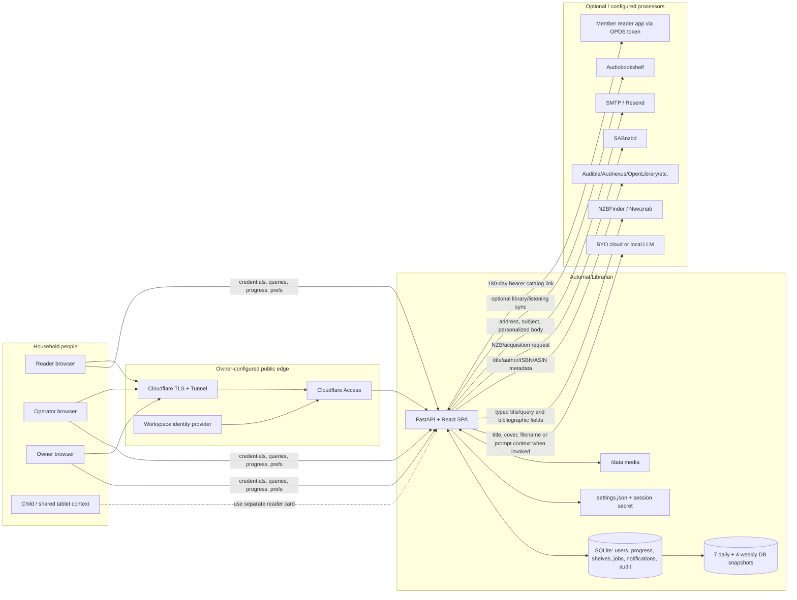

# 07 · Privacy & Compliance Lead — Librarian 360° review, run 2026-11-04

**Review target:** Automat Librarian `1.0.10` / image revision `480eff0` on LAN `:8793`  
**Assumption:** private household deployment; GDPR/CCPA-style principles used as a quality lens, not legal advice  
**Review mode:** read-only; no personal names, titles, addresses, tokens, or production rows copied into this document  
**Overall grade:** **B**  
**Companion files:** [status and platform handoff](_status.md) · [security review](06_2026-11-04_security.md) · [big decisions](31_2026-11-04_big-decisions.md) · [backlog](2026-11-04_backlog.csv)

---

# Part A — Conclusions & findings

## 1. Bottom line

Librarian earns a **B** for privacy and compliance readiness. Its deployment shape is privacy-positive by default: it is an invite-only household service, authentication is on from first boot, the public health response is minimal, reading progress and inbox rows are keyed to a member, no advertising or third-party analytics SDK is represented in the reviewed privacy contract, and the application offers a self-export plus owner-driven disable/delete path (PRIV-001, PRIV-002, PRIV-007, PRIV-009, PRIV-010).

The remaining gap is not covert ad-tech collection. It is proof and transparency around ordinary household data: what title, filename, ISBN, query, cover, email address, and access metadata can leave the box; which member-owned stores export and delete; how long catalog snapshots preserve those rows; and what Cloudflare Access records before the app sees a request. Librarian already has the beginnings of a live-config privacy notice, but disclosure must be made visible at the decision point and contract-tested as new stores and processors are added (PRIV-002–PRIV-004, PRIV-008, PRIV-009).

The single most important fix is **PRIV-003 now**: make the LLM, indexer, metadata, mail, OPDS, Audiobookshelf, SAB, and Cloudflare/identity-provider boundaries understandable before a member or keeper invokes them. The single most important thing to protect is the no-tracker, on-box, member-scoped posture (PRIV-001, PRIV-007, PRIV-010). The most important systems improvement is a personal-data registry that drives export, deletion, retention, and notice tests instead of relying on each new table to be remembered manually (PRIV-002, PRIV-009).

## 2. Key conclusions

1. **Privacy is mostly achieved by product shape, not by a consent banner.** Librarian has no public signup, no anonymous catalog, no advertising business model, and no reviewed third-party analytics SDK. A first-party session cookie is necessary to provide the requested household service, so a generic cookie banner would add ceremony without control. The product should protect this posture by requiring privacy review before any analytics, remote font, embed, crash SDK, or behavioral profiling dependency is added (PRIV-001).

2. **The member export is concrete and useful, but completeness is a contract that can drift.** `/api/auth/export` is available to every role and currently returns the member record, preferences, progress, owned shelves/items, whispers, and notifications. That is more complete than the original thin review established. It does not include sessions, security-event references, jobs/Asks attributed through `requested_by`, invites created by the member, or copies held by snapshots and third parties. Some exclusions may be correct; the problem is that no central registry explains and tests them (PRIV-002).

3. **Outbound title metadata is disclosed in code, but disclosure must reach the user before use.** The live-config privacy notice says a keeper’s identify flow may send cover and filename to the configured model and that beyond-shelf search sends typed titles to indexers. The run handoff confirms an LLM is configured. Other reviewed code shows title/author/ASIN metadata going to catalog services, and mail can receive personalized newsletter content. A member should not need to discover `/api/privacy` or infer this from Settings internals (PRIV-003).

4. **Backups are technically disciplined but remain copies of household taste.** Nightly SQLite online backups pass integrity checks, are mode `0600` inside a `0700` directory, retain seven daily and four weekly snapshots, and intentionally omit `settings.json` and `session_secret`. The database still contains account, progress, shelves, notifications, whispers, jobs, and catalog history. Deleting a live member cannot erase snapshots already taken until their 35-day window expires (PRIV-004, PRIV-009).

5. **Member isolation is strong in the reviewed progress and notification paths.** Progress reads/writes use `(user_id, work_id)`, Continue and Finished filter by the current member, notification lists and seen updates use the current user ID, private shelves require ownership, and shared shelves are explicitly marked. This finding should move from “assumed” toward “confirmed for sampled paths,” while serializers and new features still need regression tests (PRIV-007).

6. **Account disable and delete have meaningful semantics, but the product needs a durable deletion ledger.** Disable revokes active sessions. Delete removes owned shelves/items, progress, prefs, whispers, celebrations, notifications/digest queue, sessions, and resets; revokes pending invites; detaches jobs and security events; and deletes the user. Security events remain anonymized, jobs remain without requester, and snapshots age out separately. That is defensible, but every new person-linked table must join the cascade and the notice (PRIV-009).

7. **Newsletter consent is technically opt-in even when an owner forces timing.** Delivery checks the member’s newsletter-enabled preference before building or sending an edition, and “force” bypasses cadence, not opt-out. That is a strong control. The remaining weakness is comprehension: member-facing settings should distinguish in-app Inbox from email, describe weekly/monthly cadence, and explain what personal signals shape content (PRIV-006).

8. **Cloudflare Access adds a processor and a second identity/audit plane.** The owner reports Workspace-gated Access and TLS at `librarian.automat.vip`. Access necessarily handles network and identity metadata outside Librarian before requests reach the tunnel. This can be appropriate and privacy-enhancing, but the notice should identify the operator-configured edge, broad data categories, retention owner, and the fact that direct LAN access does not traverse Access (PRIV-008).

9. **Children are a usage context, not a modeled privacy role.** Librarian has owner, operator, and reader roles but no age field, parental consent record, youth-safe processor routing, or kid-specific retention. Avoiding age collection is good minimization. If children use the service, the practical control is a separate reader card on a child device, no shared owner session, and a household decision about cloud LLM/mail/OPDS exposure. Legal review is needed before representing the product as child-directed (PRIV-005).

## 3. Foundations challenged

| Assumption | Evidence for | Evidence against | Verdict | Cost of change | Rationale |
|---|---|---|---|---|---|
| A private household deployment has no privacy obligations | No public signup, sale, ads, or SaaS controller; owner controls host | Accounts, progress, notifications, IP/session metadata, reading taste, and cloud processors are still personal data | **Change** | S | Use GDPR/CCPA-style principles as design hygiene without overstating legal scope. |
| No analytics means no data leaves the box | No reviewed analytics SDK; House pulse is described as on-box totals | LLM, indexers, metadata services, SAB, mail, ABS, Cloudflare, and OPDS clients cross boundaries | **Change** | S | “No tracking” is true; “nothing leaves” is not (PRIV-003, PRIV-008). |
| A cookie banner is required for privacy maturity | Session cookie is first-party and necessary; no ad-tech observed | Future analytics or non-essential browser storage could change the analysis | **Keep banner absent** | XS | Maintain a browser-storage inventory and add consent only when a non-essential purpose exists (PRIV-001). |
| The owner can see/manage everything without explanation | Owner operates host, backups, People, queue, settings | Readers and guests may reasonably expect private progress, whispers, and notification choices | **Keep authority, clarify boundaries** | S | Host trust is unavoidable; in-app member isolation and disclosure should still be explicit (PRIV-007, PRIV-009). |
| Export code is complete because it has a named bundle | Current bundle covers major member stores | Sessions, jobs/Asks, event references, invites, backups, and third-party copies have different treatment | **Change** | M | A registry should make include/exclude/anonymize decisions testable (PRIV-002). |
| Deleting the user row proves deletion | Cascade explicitly walks many stores | Security events/jobs are anonymized, snapshots persist 35 days, new tables can drift | **Change** | M | Define “delete from live DB,” “anonymize,” and “age out” separately (PRIV-009). |
| Titles and filenames are not personal data | Often bibliographic, not identifying alone | A household reading list, rare title, child material, or filename can reveal interests and identity | **Change** | XS | Treat outbound bibliographic metadata as household data and disclose processors (PRIV-003). |
| Cloudflare Access is only a security control | It reduces public exposure and adds identity gating | It processes identity, network, device, and access-event metadata outside Librarian | **Keep with notice** | XS | Security benefit is strong; processor transparency remains necessary (PRIV-008). |
| Seven daily plus four weekly snapshots are operational only | Supports restore and integrity; secrets omitted | Catalog snapshots preserve personal reading and notification data after live deletion | **Keep with retention disclosure** | S | 35 days is bounded and proportionate if permissions and age-out are truthful (PRIV-004). |
| Children can share an adult card | Simple for a household tablet | Exposes owner/admin authority and merges private reading/activity | **Reject** | S | Use separate reader cards and decide cloud processing per household (PRIV-005). |
| Shared shelves imply shared progress | Shared collections are intentionally collaborative | Progress and Favorites are personal and keyed by user | **Reject** | XS | Keep sharing explicit at shelf level; never infer permission to expose progress (PRIV-007). |

## 4. If we built it today

A zero-based privacy design would start with a **personal-data registry** checked into the codebase. Each store and outbound flow would declare: data category, subject key, purpose, lawful/household rationale, visibility by role, export treatment, correction route, delete/anonymize treatment, retention, backup behavior, processor, and user-facing notice string. Export, account deletion, privacy notice tests, and retention checks would consume or validate the same registry.

Members would get one “My card & privacy” panel with: Download my data; view what the library stores; sign out everywhere; change password; clear reading progress; manage private/shared shelves; manage Inbox/email/newsletter preferences; see the current “what leaves the box” list; and request disable/delete. The owner would see a separate operator panel for processors, snapshot retention, Cloudflare/TLS posture, and provider rotation without seeing member-private content by default.

External calls would be described at the point of action. “Ask the house” would say that the typed query may go to configured indexers and possibly a model. Model-assisted identify would say which metadata fields are sent and name the configured provider. Mail settings would explain that subject/body/address go through the selected provider. OPDS would explain that its 180-day bearer link can reveal the catalog to anyone holding it.

The gap is moderate, not foundational. Member scoping, export, deletion, live-config notice, opt-in newsletters, bounded backups, and no-tracker posture already exist. The highest-value work is to make those behaviors visible, comprehensive, and regression-proof rather than replacing the storage or authentication model.

## 5. Findings by surface

### Public

Anonymous callers receive liveness, empty readiness, minimal features, and login/join functions—not the catalog, member list, queue, settings, or operational status. Health is process-up only. Robots and response headers discourage indexing. This is excellent data minimization at the public boundary (PRIV-010).

The public VIP is owner-reported as Cloudflare Access gated. That means most internet visitors see an identity provider before Librarian and that access metadata exists outside the application. The project has no reviewed public privacy page for that edge context; the authenticated `/api/privacy` notice covers application processors but not a full Cloudflare statement (PRIV-008). **Public grade: 4/5.**

### Consumer

The consumer surface has meaningful user-level scoping. Progress, Continue, Finished, Favorites, private shelves, whispers, preferences, and notifications use member IDs; shared shelves are explicit. Export covers the largest member-owned stores and newsletters require opt-in (PRIV-002, PRIV-006, PRIV-007).

The weakest consumer point is discoverability. Members need a visible privacy/card panel that explains external processors and deletion limits before using Ask, model-assisted features, email, OPDS, or ABS. Children need separate reader accounts and household guidance because there is no youth data mode (PRIV-003, PRIV-005). **Consumer grade: 4/5.**

### Owner

Owners can configure every processor, issue/reset cards, disable/delete members, push newsletters, run maintenance, and access host backups. That power is justified in a self-hosted household, but the UI should clearly separate operational metadata from member-private data and explain deletion/anonymization consequences (PRIV-004, PRIV-009).

The owner also carries responsibility for Cloudflare, VLAN, provider terms, backups, and legal/jurisdiction decisions. Librarian can make those responsibilities legible without pretending to be a compliance management product. **Owner grade: 3/5.**

### Admin / operations

Admin privacy strengths include mode-protected backup directories, bounded 35-day snapshot retention, omission of API/session secrets from catalog snapshots, security-event anonymization on member deletion, and live-config-dependent privacy copy. The app records IP and user agent in sessions, which is useful for security but should have a stated retention tied to session expiry/revocation (PRIV-004, PRIV-008, PRIV-009).

The operations gap is evidence: no central personal-data register, no automated “all person-linked stores are exported/deleted/declared” test, and no reviewed Cloudflare retention evidence. **Admin grade: 3/5.**

## 6. Findings by theme

**Minimization.** Best: no ad-tech, no public catalog, no age field, minimal health, and member-keyed stores. Risk: filenames, typed search, title metadata, email addresses, IPs, and user agents still exist because the service needs them. Direction: collect only for a named purpose and register every addition (PRIV-001, PRIV-003, PRIV-010).

**Transparency.** Best: `/api/privacy` derives model/indexer/mail statements from live settings. Gap: it is not necessarily encountered before use and does not fully explain Cloudflare, all metadata providers, SAB, ABS, or exact export exclusions. Direction: a visible “What leaves this server” panel plus contextual copy (PRIV-003, PRIV-008).

**Access and isolation.** Best: current-user predicates on progress and notifications; explicit private/shared shelf rules. Gap: broad owner/host authority is inherent and deserves plain disclosure. Direction: preserve query-time scoping and add multi-reader regression tests (PRIV-007).

**Rights.** Best: self-export and owner disable/delete exist. Gap: no registry proves future completeness; correction and self-service deletion controls are limited. Direction: “My card & privacy,” registry-backed export, and documented owner workflow (PRIV-002, PRIV-009).

**Retention.** Best: snapshots are bounded to seven daily and four weekly; invites/resets have expiries; sessions have expiries. Gap: security events and application rows do not have one consolidated schedule in the reviewed evidence. Direction: publish a category schedule and automate where proportionate (PRIV-004, PRIV-009).

**Consent and communications.** Best: newsletter delivery checks explicit enabled preference, and forced owner pushes do not override opt-out. Gap: member settings should distinguish Inbox and email and explain personalization. Direction: protect opt-in and add precise channel/cadence copy (PRIV-006).

**Third parties and cross-border transfer.** Owner-configured providers may include Cloudflare, LLM vendors, Newznab/indexers, metadata services, SMTP/Resend, SAB, Audiobookshelf, and client OPDS apps. Jurisdiction and transfer mechanism depend on operator/provider choices and need legal review if the deployment extends beyond a personal household (PRIV-003, PRIV-008).

**Children and sensitive interests.** The product does not collect age, which is good. Reading history can still reveal religion, health, sexuality, politics, or a child’s interests. Direction: separate reader cards, no shared owner session, and a household policy for cloud processing (PRIV-005, PRIV-007).

## 7. Stop doing

1. Stop saying or implying “nothing leaves the box”; say “no advertising or analytics tracking,” then name configured processors (PRIV-001, PRIV-003).
2. Stop treating titles, filenames, ISBNs, and queries as non-sensitive merely because they are bibliographic (PRIV-003).
3. Stop adding user-linked tables without export/delete/retention registration (PRIV-002, PRIV-009).
4. Stop treating deletion from the live database as deletion from existing snapshots or provider systems (PRIV-004, PRIV-009).
5. Stop sharing an owner session on child or guest devices (PRIV-005).
6. Stop sending newsletters or email by default; preserve explicit per-member opt-in (PRIV-006).
7. Stop exposing personal progress merely because a shelf is shared; keep the concepts separate (PRIV-007).
8. Stop describing Cloudflare Access only as “SSL and protection”; it is also an identity/access-data processor (PRIV-008).
9. Stop adding public health details beyond liveness/readiness (PRIV-010).
10. Stop writing review evidence that includes actual household names, titles, email addresses, IPs, or tokens.

## 8. Strengths worth protecting

- Protect the no-advertising, no-third-party-analytics posture and self-hosted application boundary (PRIV-001).
- Protect mandatory household auth and the exhaustive public handshake (PRIV-010).
- Protect member-scoped progress, Continue, Finished, Favorites, prefs, whispers, and notifications (PRIV-007).
- Protect explicit private/shared shelf flags rather than implicit household visibility.
- Protect self-export for all roles and security-event logging of export (PRIV-002).
- Protect owner disable revoking sessions and owner delete walking person-linked stores (PRIV-009).
- Protect opt-in newsletter delivery even when an owner forces timing (PRIV-006).
- Protect live-config privacy copy that changes when LLM/indexer/mail is configured (PRIV-003).
- Protect bounded, permissioned, integrity-checked catalog snapshots and omission of secrets (PRIV-004).
- Protect minimal public health and owner-only operational status (PRIV-010).

## 9. Risks of inaction

Within 6–12 months, new features can add another person-linked table or outbound provider without joining export, deletion, retention, or notice. The current code is explicit but manual, so privacy correctness decays by omission rather than by deliberate policy (PRIV-002, PRIV-009).

Members may reasonably believe “household library on this box” means their title activity never leaves the host. Model identify, beyond-shelf search, cover/metadata lookup, newsletters, Cloudflare Access, and OPDS create legitimate exceptions. If those exceptions are discovered after a sensitive query or title is sent, the trust harm is larger than the data volume (PRIV-003, PRIV-008).

Snapshots preserve deleted member data for up to 35 days. That is proportionate for recovery, but an undisclosed copy can make a deletion promise feel false. Broad appdata sharing can also expose household taste even though settings secrets are omitted (PRIV-004, PRIV-009).

A shared owner session on a child’s or guest’s device exposes far more than reading functionality, while a shared reader account merges progress and preferences. Without explicit household guidance, convenience can defeat the otherwise strong member model (PRIV-005, PRIV-007).

## 10. Recommended direction

**Now, 0–2 weeks.** Ship visible, contextual “What leaves the box” disclosure for configured LLM/indexer/metadata/mail/Cloudflare/OPDS/ABS/SAB paths. The copy should distinguish automatic keeper identify, member-initiated Ask/beyond search, notifications, and public-edge access. PRIV-003 is explicitly **Now** and should precede growth of model-assisted chase/list features.

Correct and surface the current rights statement: export includes account metadata, prefs, progress, owned shelves/items, whispers, and notifications; owner deletion removes live rows and anonymizes/detaches some operational records; snapshots can retain copies for up to 35 days. Preserve newsletter opt-in and public health minimalism (PRIV-002, PRIV-004, PRIV-006, PRIV-009, PRIV-010).

**Next, 2–6 weeks.** Create the personal-data registry and tests; add a member-facing privacy/card panel; document Cloudflare as operator-configured edge processing; verify backup directory/share ACLs; add multi-reader isolation tests across work detail, Hall, shelves, notifications, and export (PRIV-002, PRIV-004, PRIV-007–PRIV-009).

**Later, 6+ weeks.** Decide whether to offer self-service progress clearing or account deletion; add child/shared-tablet guidance; define a category retention schedule for sessions, security events, notifications, jobs, and operational records; obtain legal review only if deployment purpose/jurisdiction makes it necessary (PRIV-005, PRIV-009).

**Ninety-day success indicators:**

- 100% of configured outbound processors appear in the member/owner privacy panel.
- 100% of person-linked stores are registered with export/delete/retention treatment.
- Export and deletion contract tests fail when an unregistered store is introduced.
- 0 newsletters are delivered to an opted-out member, including owner force-push.
- 0 cross-member progress or private-shelf rows appear in multi-reader tests.
- Existing snapshots age out deleted member rows within the stated 35-day maximum.
- Public health continues to return only liveness; owner status remains authenticated.

## 11. Scorecard

| Surface | Minimization | Transparency | Rights / control | Isolation | Retention | Third parties | Overall |
|---|---:|---:|---:|---:|---:|---:|---:|
| Public | 5/5 | 3/5 | n/a | 5/5 | n/a | 3/5 — Access notice gap | **4/5** |
| Consumer | 4/5 | 3/5 | 3/5 | 4/5 | 3/5 | 3/5 | **4/5** |
| Owner | 4/5 | 3/5 | 4/5 | 3/5 — inherent host authority | 3/5 | 3/5 | **3/5** |
| Admin / Ops | 4/5 | 3/5 | 3/5 | 4/5 | 3/5 | 3/5 | **3/5** |

---

# Part B — Detailed findings

## 12. Scope & method

Reviewed the run handoff, `docs/SECURITY.md`, `docs/ops/AUTOMAT.md`, `AGENTS.md`, the current privacy notice/export module, auth and People routes, People repository export/deletion methods, progress/shelf repository, notifications/newsletters, settings persistence/masking, frontend API calls, and LLM/indexer-related paths through Codegraph.

Runtime truth is Automat `1.0.10` / `480eff0` at LAN `:8793`. The run handoff records two users, LLM configured, one indexer host, active catalog/progress data, and last backup on 2026-11-04. This document does not repeat household names, member identities, titles, queue content, addresses, IPs, tokens, or keys.

The owner reports that `librarian.automat.vip` uses Cloudflare TLS and Workspace-gated Access and that guests are separated by VLAN. No Cloudflare account, Access log, IdP setting, firewall, router, provider retention policy, data-processing agreement, or jurisdiction was inspected. Legal conclusions therefore remain out of scope.

No export was downloaded from production, no member was disabled/deleted, no newsletter was sent, no LLM/indexer request was triggered, and no database row or backup was opened. Completeness claims are based on current code paths, not production-row enumeration.

## 12.1 Data inventory

| Data category | Current store | Subject / access | Purpose | Outbound flow | Retention / rights evidence |
|---|---|---|---|---|---|
| Account identity | `users` | self; owner/op public People view | authentication and household role | Cloudflare identity is separate; local username not sent by app processors in reviewed notice | export includes ID/name/role/timestamps; owner delete removes row |
| Password verifier | `users.password_hash` | server/host | local authentication | none | not exported; deleted with user |
| Session token | HttpOnly cookie | member device | authentication | sent to Librarian origin; VIP transits Cloudflare | max age 30 days; revoke/logout/disable/delete paths |
| Session metadata | `sessions` | server/host | revocation and security | IP/UA originate at client/proxy | deleted on user delete; retention otherwise tied to session lifecycle not consolidated |
| Preferences | `user_prefs` | self; server | appearance, notifications, newsletter | notification email goes to configured mail transport | exported and deleted |
| Reading progress | `progress` | self-scoped routes | Continue/Finished/reader position | optional ABS synchronization may share listening state | exported and deleted |
| Favorites/private shelves | `shelves`, `shelf_items` | owner member; private by default | personal organization | none inherent | exported and deleted |
| Shared shelves | same | household when `shared=1` | collaboration | none inherent | export includes member-owned shelves; delete removes owned shelves |
| Whispers | `whispers` | member-related | household notes | may appear in member UI; model flow not established here | exported and deleted |
| Inbox notifications | `user_notifications` | self | arrivals, newsletters, reminders | email transport if enabled/opted in | exported and deleted |
| Digest queue | `notification_digest_queue` | server | delayed communication | SMTP/Resend | deleted on member delete |
| Newsletter preference/content | prefs + notification rows | self; owner can trigger timing | household library letter | SMTP/Resend sees address, subject, body | opt-in required; rows exported via notifications |
| Asks/jobs | `jobs.requested_by` and job data | reader attribution; owner/op queue | acquisition workflow | indexer sees query; SAB receives NZB/work | requester detached on user delete; not in current export |
| Invites | `invites` | owner/op management | household joining | link may transit messaging channel outside app | pending invites by deleted creator revoked; not in export |
| Password resets | `password_resets` | target and owner issuer | recovery | link delivery is operator-controlled | deleted with user; single-use/expiry described in notice |
| Security events | `security_events` | owner/host | audit and incident response | none reviewed | user/actor IDs nulled on deletion; not exported |
| Catalog metadata | works/files/authors/editions | authenticated household | library display and search | metadata/cover services, indexers, model may see title/author/filename/IDs | database snapshots retain catalog/taste context |
| Media bytes | `/data` | authenticated/OPDS token paths | reading/listening | OPDS/Audiobookshelf/client receives content | outside member export; host-managed media lifecycle |
| OPDS token | token store/link | member client | reader-app access | bearer link leaves browser when copied | notice says 180 days; anyone with link can browse |
| Integration credentials | `settings.json` / env | owner/host; masked API | access external providers | sent only to configured provider | excluded from catalog snapshots; mode `0600`; no member export |
| Cloudflare access metadata | Cloudflare/IdP systems | operator/provider | TLS, identity gate, access logs | Cloudflare and Workspace IdP | owner/provider controlled; not in Librarian export/delete |
| Catalog snapshots | `/config/backups/*.db` | host/backup operator | disaster recovery | none unless operator copies them | seven daily/four weekly; up to 35 days; not changed by live delete |

## 12.2 Data flow map

**Boundary interpretation:** The diagram shows possible configured flows, not a claim that every provider receives every field. Exact payloads vary by feature and provider. The disclosure must be feature-specific and generated from live configuration where possible.

## 13. Strengths

### PRIV-001: Protect the no-tracker, household-hosted posture

| Field | Value |
|---|---|
| Type | Strength |
| Surface | Cross-cutting |
| Persona(s) | all household members |
| Category | Minimization / tracking |
| Severity | High |
| Impact | 5 |
| Effort | S |
| Confidence | Confirmed |
| Priority score | 7.50 |
| Verdict | Protect |
| Dependencies | PRIV-003 |
| Labels | no-analytics, self-hosted, minimization |

**Evidence:** `librarian/privacy.py:13-20,50-53`; `docs/SECURITY.md:13-16,40-58`; `librarian/web/app.py:117-137`; run handoff `_status.md:18-36`.

**Current state:** The application declares no advertising sale or third-party analytics SDK, keeps House pulse as on-box household totals, requires authentication for the catalog, and exposes only a small public handshake.

**Root cause:** Librarian is designed as a private household utility rather than a growth-funded SaaS.

**Recommendation:** Protect this posture with a privacy review gate for new SDKs, scripts, fonts, embeds, crash reporting, analytics, and browser storage. Prefer on-box aggregate counters and short retention.

**Rationale:** Reading taste is sensitive even in small households. The absence of trackers removes a broad class of profiling, consent, transfer, and security concerns. A generic cookie banner was rejected because there is no reviewed non-essential tracking purpose to control. Protect now because adding an SDK later is easy and hard to unwind.

**User story:** As a member, I want my library use free from advertising and third-party behavioral tracking so that reading remains a household activity.

**Acceptance criteria:**
- [ ] No third-party analytics or advertising SDK ships without an explicit decision.
- [ ] Browser storage inventory distinguishes necessary from optional purposes.
- [ ] House pulse remains aggregate and on-box.
- [ ] Public catalog access remains closed.

**Success metric:** Zero unregistered tracker/network SDKs; zero personal funnel events leaving the host.

**Validation:** Dependency/source/CSP review and browser network inspection on a test instance.

### PRIV-010: Protect minimal public health and authenticated operational status

| Field | Value |
|---|---|
| Type | Strength |
| Surface | Public |
| Persona(s) | all members, maintainer |
| Category | Public disclosure |
| Severity | Medium |
| Impact | 4 |
| Effort | XS |
| Confidence | Confirmed |
| Priority score | 8.00 |
| Verdict | Protect |
| Dependencies | None |
| Labels | health, readiness, public, minimization |

**Evidence:** `librarian/web/routers/auth.py:75-105`; `docs/SECURITY.md:40-58`; `AGENTS.md:52-68`.

**Current state:** Liveness returns only `{status:"ok"}`; readiness returns an empty 200/503 body; detailed status is owner-only. Minimal features expose foyer necessities.

**Root cause:** Operations truth and public liveness were intentionally separated.

**Recommendation:** Preserve this split. Do not add backup time, poller age, provider status, revision, user count, catalog counts, or network posture to public health.

**Rationale:** Public monitors need availability, not household operations. Authentication on health would complicate orchestration; adding details would leak unnecessary household/system information. Protect now because health endpoints tend to accumulate diagnostics.

**User story:** As an owner, I want public monitors to learn only whether the process is up so that operations details stay private.

**Acceptance criteria:**
- [ ] Public liveness body remains exact and minimal.
- [ ] Public readiness contains no diagnostic fields.
- [ ] Detailed status requires owner role.
- [ ] Tests fail on new public fields.

**Success metric:** Zero operational or household fields in public health/readiness.

**Validation:** Read-only anonymous requests and route tests.

## 14. Weaknesses

### PRIV-003: Disclose every configured outbound metadata flow at the point of use

| Field | Value |
|---|---|
| Type | Weakness |
| Surface | Consumer / Owner |
| Persona(s) | reader, operator, owner |
| Category | Transparency / third parties |
| Severity | High |
| Impact | 4 |
| Effort | S |
| Confidence | Confirmed |
| Priority score | 6.00 |
| Verdict | Fix |
| Dependencies | PRIV-001, PRIV-008 |
| Labels | llm, indexer, metadata, disclosure, now |

**Horizon:** **Now (0–2 weeks).**

**Evidence:** `librarian/privacy.py:22-49,54-61`; `librarian/llm.py:507-530`; `librarian/web/schemas.py:121-156`; `librarian/audnexus.py:228-310`; `_status.md:31-36` records LLM configured and one indexer; `frontend/src/api.js:83-107,273-282`.

**Current state:** The authenticated privacy notice conditionally explains model identify, beyond-shelf indexers, mail, OPDS, and snapshots. It is not necessarily visible before a member triggers Ask/beyond search or before an owner runs model-assisted identify/list work. Metadata-provider, Cloudflare, SAB, and ABS boundaries need a clearer combined view.

**Root cause:** Processor disclosures were added feature-by-feature and live in an API notice rather than a prominent product surface and action context.

**Recommendation:** Add:

- A member “What leaves this server” panel generated from live configuration.
- Inline Ask/beyond copy naming indexer/model categories before submit.
- Keeper identify copy listing title/filename/cover/identifier categories.
- Mail copy naming address, subject, body, cadence, and configured transport.
- OPDS warning that the bearer link exposes catalog access for 180 days.
- Operator copy for Cloudflare Access, SAB, metadata sources, and ABS.
- A provider-policy link field where an operator can document chosen vendor terms.

Do not show API keys or claim provider retention terms the app cannot know.

**Rationale:** Reading/search metadata can reveal sensitive interests. Disclosure supports informed household choice and makes BYO providers an explicit operator responsibility. Disabling all integrations was rejected because they are core optional capabilities; a vague global notice was rejected because it is easy to miss. This is Now because the LLM is configured and disclosure is cheap compared with retroactive trust repair.

**User story:** As a member, I want to know what leaves the household before I search or ask so that I can choose whether to use that feature.

**Acceptance criteria:**
- [ ] Configured processors appear in one visible privacy panel.
- [ ] Ask/beyond and model identify have contextual disclosure.
- [ ] Copy lists data categories without exposing secrets.
- [ ] Local-only provider configurations are distinguished from cloud providers.
- [ ] Tests cover notice changes when providers are enabled/disabled.

**Success metric:** 100% of outbound processor classes registered and disclosed; user testing finds the answer in under 30 seconds.

**Validation:** Toggle mocked configurations and assert panel/action copy and network destinations.

### PRIV-002: Contract-test member export completeness and exclusions

| Field | Value |
|---|---|
| Type | Weakness |
| Surface | Consumer |
| Persona(s) | reader, operator, owner |
| Category | Access / portability rights |
| Severity | Medium |
| Impact | 3 |
| Effort | M |
| Confidence | Confirmed |
| Priority score | 2.00 |
| Verdict | Fix |
| Dependencies | PRIV-009 |
| Labels | export, rights, registry, portability |

**Evidence:** `librarian/web/routers/auth.py:222-233`; `librarian/repositories/people.py:416-480`; `librarian/privacy.py:66-69`; `frontend/src/api.js:50-53`.

**Current state:** Self-export includes identity metadata, prefs, progress, owned shelves/items, whispers, and notifications. It excludes password hashes and integration secrets, correctly. It also omits sessions, requester-linked jobs/Asks, invites, security-event references, snapshots, and third-party copies; those need explicit include/exclude/anonymize reasons.

**Root cause:** Export is a manually maintained query bundle rather than a schema-level contract.

**Recommendation:** Create a registry and a contract test that enumerates every person-linked store. For each, decide include, summarize, exclude with reason, or not-applicable. Add export version, generated-at time, field descriptions, and snapshot/provider limitations.

**Rationale:** The current export is useful and should not be replaced. A broad raw database export would expose other members and secrets; manual documentation alone drifts. Registry-backed tests are worth doing Next because rights already exist but future completeness is not guaranteed.

**User story:** As a member, I want a complete, understandable copy of data associated with my card so that I can review or move it without exposing the household.

**Acceptance criteria:**
- [ ] Registry covers every person-linked table/field.
- [ ] Export includes or explains each registered category.
- [ ] Other members’ private data and secrets never appear.
- [ ] Export schema has a version and generated timestamp.
- [ ] Security event records the export without storing its contents.

**Success metric:** 100% registry coverage; zero cross-member fields in export tests.

**Validation:** Seed two synthetic users with data in every registered store and compare exported subject IDs.

### PRIV-004: Make backup taste-data retention and access explicit

| Field | Value |
|---|---|
| Type | Weakness |
| Surface | Owner / Admin |
| Persona(s) | owner, maintainer, deleted member |
| Category | Retention / backups |
| Severity | Medium |
| Impact | 3 |
| Effort | S |
| Confidence | Confirmed |
| Priority score | 3.00 |
| Verdict | Fix |
| Dependencies | OPS-008, PRIV-009 |
| Labels | backups, retention, acl, deletion |

**Evidence:** `docs/ops/AUTOMAT.md:153-184`; `docs/SECURITY.md:93-113`; `librarian/privacy.py:18-20,58-61`; `_status.md:20-24`.

**Current state:** Seven daily and four weekly SQLite snapshots are integrity-checked, mode `0600`, and stored in a `0700` directory. The notice describes a maximum 35-day age-out. Settings and session secret are excluded, but member and catalog data remain.

**Root cause:** Backups correctly optimize recoverability, while privacy consequences rely on operator understanding.

**Recommendation:** Document categories present, 35-day maximum, ACL owner, restore access, deletion lag, and manual-copy exception. Verify Unraid/SMB exposure and ensure ad hoc pre-maintenance snapshots have a cleanup rule.

**Rationale:** Removing backups would create unacceptable reliability risk. Immediate rewriting of all snapshots after deletion is complex and can corrupt recovery chains. Bounded age-out with truthful notice and strong permissions is proportionate. Do the ACL/disclosure work Now/Next because it is low effort.

**User story:** As a member, I want to know how long deleted data remains in recovery copies so that “delete” has an honest meaning.

**Acceptance criteria:**
- [ ] Notice states live deletion versus snapshot age-out.
- [ ] Backup directory/file modes remain 0700/0600.
- [ ] Settings and session secret remain excluded.
- [ ] Manual/pre-maintenance snapshots have an owner and retention rule.
- [ ] Shared backup destinations are documented.

**Success metric:** All routine snapshots comply with retention and permissions; deleted synthetic data disappears after the declared window.

**Validation:** Inspect backup manifests/permissions and perform a synthetic age-out test on a clone.

### PRIV-006: Make newsletter and mail consent legible without weakening opt-in

| Field | Value |
|---|---|
| Type | Weakness |
| Surface | Consumer |
| Persona(s) | reader, operator, owner |
| Category | Consent / communications |
| Severity | Low |
| Impact | 2 |
| Effort | S |
| Confidence | Confirmed |
| Priority score | 1.00 |
| Verdict | Fix |
| Dependencies | PRIV-003 |
| Labels | newsletter, email, opt-in, cadence |

**Evidence:** `librarian/notifications/newsletters.py:199-218,221-285,277-372`; `librarian/web/routers/notifications.py:87-133,169-197`; `librarian/privacy.py:44-49`.

**Current state:** Newsletter delivery requires the member’s enabled preference. Owner `force` bypasses cadence only; it still cannot force-email an opted-out member. Disabled users are skipped. Inbox and email behavior are configured through member prefs.

**Root cause:** The backend consent model is stronger than the thin user-facing review evidence.

**Recommendation:** Preserve opt-in. Clarify channel, cadence, personalization inputs, email transport, test behavior, and one-click opt-out. Quiet hours should apply consistently where promised, but newsletter cadence need not be treated as real-time notification.

**Rationale:** Consent should be understandable, not merely technically present. Making newsletters owner-mandatory or adding a generic marketing-consent framework would be inappropriate for a household product. Improve copy Next; keep enforcement now.

**User story:** As a member, I want clear control over Inbox and email letters so that communication is expected and reversible.

**Acceptance criteria:**
- [ ] Newsletter defaults disabled for a new member.
- [ ] Owner push cannot override opt-out.
- [ ] UI distinguishes Inbox, email, cadence, and test.
- [ ] Opt-out takes effect before the next delivery.
- [ ] Configured mail provider is disclosed.

**Success metric:** Zero opted-out deliveries; 100% preference-state tests pass.

**Validation:** Synthetic opted-in/out, disabled, forced, weekly, and monthly delivery tests.

### PRIV-007: Preserve and regression-test member progress isolation

| Field | Value |
|---|---|
| Type | Weakness |
| Surface | Consumer |
| Persona(s) | reader, operator, owner |
| Category | Intra-household exposure |
| Severity | Medium |
| Impact | 3 |
| Effort | M |
| Confidence | Likely |
| Priority score | 1.60 |
| Verdict | Fix |
| Dependencies | PRIV-002 |
| Labels | progress, idor, isolation, shelves |

**Evidence:** `librarian/repositories/shelves.py:17-96,103-157,201-232,300-319,321-416`; `librarian/web/routers/notifications.py:52-84`; `librarian/repositories/people.py:416-480`; `frontend/src/api.js:314-315`.

**Current state:** Sampled persistence paths key progress by user and work, query Continue/Finished by user, isolate Favorites, mark named shelves private/shared, and query notifications by user. This is strong. The review did not dynamically inspect every serializer/Hall/work-detail response with two live reader accounts.

**Root cause:** Privacy depends on consistently carrying the actor ID through repositories and serializers.

**Recommendation:** Add a two-reader isolation suite covering work detail, Hall rails, Continue, Finished, Favorites, private/shared shelves, whispers, notifications, export, and deletion. Shared shelves may expose shelf contents, never progress.

**Rationale:** Query-time scoping is the right pattern and should be protected, not redesigned. A broad owner-visible activity feed would erode household trust. Test Next because the static evidence is good but one serializer regression could become a visible leak.

**User story:** As a reader, I want my place, private shelves, whispers, and Inbox isolated from other cards so that household membership does not erase personal boundaries.

**Acceptance criteria:**
- [ ] Reader A never receives Reader B progress/private shelves/notifications.
- [ ] Shared shelf content is visible only when explicitly shared.
- [ ] Shared shelf visibility does not expose member progress.
- [ ] Owner APIs expose only data justified by administration.
- [ ] Export contains only the requester’s stores.

**Success metric:** Zero cross-user rows in the two-reader matrix.

**Validation:** Seed distinct synthetic data and assert API payloads for owner/op/reader.

### PRIV-009: Make disable, delete, anonymize, and backup age-out a tested contract

| Field | Value |
|---|---|
| Type | Weakness |
| Surface | Admin / Consumer |
| Persona(s) | member, owner |
| Category | Deletion / rights |
| Severity | Medium |
| Impact | 3 |
| Effort | M |
| Confidence | Confirmed |
| Priority score | 2.00 |
| Verdict | Fix |
| Dependencies | PRIV-002, PRIV-004 |
| Labels | deletion, disable, cascade, anonymize |

**Evidence:** `librarian/web/routers/auth.py:392-428`; `librarian/repositories/people.py:482-536`; `librarian/privacy.py:58-61`; `frontend/src/api.js:57-65`.

**Current state:** Disable revokes sessions. Delete blocks owner/self deletion, removes member-owned stores, revokes pending invites, detaches requester identity from jobs, nulls security-event subject/actor IDs, and deletes the account. Existing snapshots persist until age-out. The function comment relies partly on foreign keys for new tables, which needs a schema-level test.

**Root cause:** Deletion is manually orchestrated across current user-ID columns, while audit/operations records intentionally survive in anonymized form.

**Recommendation:** Define four outcomes: disable; delete live personal content; anonymize operational records; expire backup/provider copies. Drive cascade tests from the personal-data registry and show the owner/member a pre-delete summary.

**Rationale:** Hard-deleting audit/job history can damage integrity and incident response; retaining direct identity forever is unnecessary. Anonymization plus bounded backups is the balanced approach. Do Next because the current behavior is meaningful but future schema drift is the main risk.

**User story:** As a member, I want deletion to remove my live personal content and clearly explain what remains and why.

**Acceptance criteria:**
- [ ] Disable revokes all active sessions.
- [ ] Delete removes every registry category marked delete.
- [ ] Audit/job survivors are anonymized and documented.
- [ ] Existing snapshots age out within 35 days.
- [ ] UI states that provider copies follow provider/operator terms.

**Success metric:** Zero direct subject identifiers across delete-designated stores after synthetic deletion; backups age out on schedule.

**Validation:** Clone database, seed every registered category, delete, query registry assertions, and test snapshot expiry.

## 15. Opportunities

### PRIV-005: Add child and shared-tablet privacy guidance without collecting age

| Field | Value |
|---|---|
| Type | Opportunity |
| Surface | Consumer |
| Persona(s) | child reader, parent/guardian, guest |
| Category | Children / shared devices |
| Severity | Medium |
| Impact | 3 |
| Effort | L |
| Confidence | Suspected |
| Priority score | 0.80 |
| Verdict | Investigate |
| Dependencies | PRIV-003, PRIV-007 |
| Labels | children, shared-tablet, legal-review |

**Evidence:** `librarian/auth.py:277-283` defines owner/op/reader authorization; `librarian/web/routers/auth.py:175-227,346-428` exposes card/session/People controls; no age or youth-specific role appears in the reviewed auth model.

**Current state:** A child can use a reader card, but there is no child-specific data mode, cloud-provider restriction, parental consent record, or age collection. Shared sessions merge progress and authority.

**Root cause:** Librarian models household capability, not legal age.

**Recommendation:** Keep age uncollected. Publish guidance: create separate reader cards; never share owner sessions; decide whether child searches/model identify/mail/OPDS are appropriate; use local providers where desired; review provider age terms. Investigate a “restricted reader” only if real household needs justify it.

**Rationale:** Collecting date of birth would create more sensitive data and still not solve device sharing. A full child-compliance subsystem is disproportionate for a household kit. Guidance and separate accounts are low-risk; legal review is required before child-directed claims.

**User story:** As a guardian, I want a safe reader setup on a shared tablet so that a child does not inherit owner access or another person’s activity.

**Acceptance criteria:**
- [ ] HELP recommends separate reader cards and no shared owner session.
- [ ] Privacy panel explains child-related outbound processors.
- [ ] No age/date-of-birth field is added without a legal/product decision.
- [ ] Restricted-reader need is validated before implementation.

**Success metric:** Household setup guidance is discoverable; zero owner-session recommendations for child devices.

**Validation:** Documentation review and shared-tablet journey QA.

### PRIV-008: Add Cloudflare Access and identity-provider processing to operator disclosure

| Field | Value |
|---|---|
| Type | Opportunity |
| Surface | Public / Admin |
| Persona(s) | remote member, owner, maintainer |
| Category | Processor transparency |
| Severity | Low |
| Impact | 2 |
| Effort | XS |
| Confidence | Confirmed as ops evidence |
| Priority score | 2.00 |
| Verdict | Add |
| Dependencies | SEC-006, SEC-007 |
| Labels | cloudflare, access, idp, logs, tls |

**Evidence:** owner note in `31_2026-11-04_big-decisions.md:20`; `_status.md:23-24`; `docs/ops/AUTOMAT.md:38-46,121-128`; `docs/SECURITY.md:18-37`.

**Current state:** Owner reports TLS and Workspace-gated Cloudflare Access at the VIP. Cloudflare/IdP configuration and retention were not independently inspected. Direct LAN traffic does not necessarily traverse this processor.

**Root cause:** Operations documentation treats Cloudflare primarily as security/network infrastructure rather than as a privacy boundary.

**Recommendation:** Add an operator-owned disclosure entry: purpose, data categories (identity assertion, source/network/device/access event as applicable), route scope, retention owner, provider-policy link, and deletion/access limitations. Avoid claiming exact fields or retention until configuration is reviewed.

**Rationale:** Access materially improves security and can reduce unwanted data exposure, so removal is not recommended. Transparency is nearly free and prevents an inaccurate “all activity stays only in Librarian” interpretation. Do Next alongside the security configuration review.

**User story:** As a remote member, I want to know that the public gate and identity provider process access metadata so that remote access is transparent.

**Acceptance criteria:**
- [ ] Operator notice names Cloudflare Access and Workspace identity category.
- [ ] It distinguishes VIP from direct LAN traffic.
- [ ] Retention links/owner are configuration-based, not invented.
- [ ] No Access tokens, policy IDs, emails, or logs appear in public docs.

**Success metric:** Processor register contains reviewed Cloudflare/IdP entry with annual review date.

**Validation:** Compare disclosure with non-secret Access/tunnel configuration.

## 16. Remediation plan

| Horizon | ID | Action | Effort | Owner role | Dependencies |
|---|---|---|---:|---|---|
| Now | PRIV-003 | Add visible live-config “What leaves this server” disclosure and contextual copy | S | Product / Privacy | None |
| Now | PRIV-004 | Confirm backup ACLs and publish 35-day deletion lag | S | Maintainer | OPS-008 |
| Now | PRIV-006 | Preserve opt-in; clarify channels/cadence | S | Frontend / Product | PRIV-003 |
| Next | PRIV-002 | Build personal-data registry and export contract tests | M | Backend / Privacy | PRIV-009 |
| Next | PRIV-007 | Add two-reader isolation matrix | M | Backend / QA | PRIV-002 |
| Next | PRIV-008 | Register Cloudflare/IdP processing from reviewed ops config | XS | Maintainer | SEC-006 |
| Next | PRIV-009 | Registry-drive deletion/anonymization tests and pre-delete summary | M | Backend / Privacy | PRIV-002, PRIV-004 |
| Later | PRIV-005 | Add child/shared-tablet guidance; validate restricted-reader demand | S–L | Product / Legal | PRIV-003, PRIV-007 |
| Protect | PRIV-001 | Keep tracker-free, on-box aggregate posture | S | All maintainers | None |
| Protect | PRIV-010 | Keep public health minimal | XS | Backend | None |

**Sequencing rationale:** Disclosure comes first because configured external flows exist now and copy is reversible. The registry then provides the foundation for export, deletion, and retention proof. Children/shared-tablet expansion waits for validated need and legal context; minimization and public non-disclosure remain continuous guardrails.

## 17. Quick wins

1. Put “What leaves this server” in member-visible card/privacy settings.
2. Show configured model category and whether it appears local or remote.
3. Add one-line disclosure beside Ask/beyond submit.
4. Explain that title, author, ISBN/ASIN, cover, or filename may be processor inputs depending on feature.
5. Explain that newsletter opt-in controls both generated editions and email delivery behavior.
6. Add export field categories and exclusions to the privacy panel.
7. Add “live DB now; snapshots up to 35 days” to delete confirmation.
8. Document separate reader cards for shared/child devices.
9. Register Cloudflare Access/Workspace as operator-configured edge processing.
10. Add a CI assertion that public health remains minimal.

## 18. Open questions needing product, operator, or legal input

1. Which LLM provider is configured, and is it local or cloud? Do not record the key.
2. Which metadata services are enabled in production, and what exact fields does each feature send?
3. Should member export include requester-linked Asks/jobs, session metadata, and anonymized audit references?
4. Should a member be able to self-clear progress or request self-deletion, or remain owner-mediated?
5. How long should revoked/expired sessions and security events remain?
6. Are pre-maintenance snapshots governed by the same 35-day maximum?
7. What Cloudflare Access and Workspace log retention applies to this app?
8. Are remote users only household members, or does the deployment include friends/extended households across jurisdictions?
9. Do children use Librarian, and if so, are cloud model/search/mail features appropriate for their reader cards?
10. Which legal jurisdiction, if any, requires a formal notice, processor agreement, or data-subject workflow?

## 19. Honest limits and thin gaps

- No production export was downloaded, so payload correctness was established from code, not live rows.
- No delete/disable was executed, so cascade behavior was not dynamically proven against the deployed schema.
- No schema-wide automated enumeration was available; the proposed registry is the fix for that evidence gap.
- No Cloudflare, Workspace, router, firewall, provider, mail, indexer, LLM, SAB, ABS, or OPDS-client account was inspected.
- Provider retention, training, cross-border transfer, and child-eligibility terms were not reviewed.
- No legal jurisdiction or controller/processor role was established; this is not legal advice.
- No personal production data was copied into the review.
- The platform-map artifact was not present under the expected `00_2026-11-04_platform-map.md` filename; `_status.md`, current docs, code, and the run’s existing review artifacts supplied platform context.
