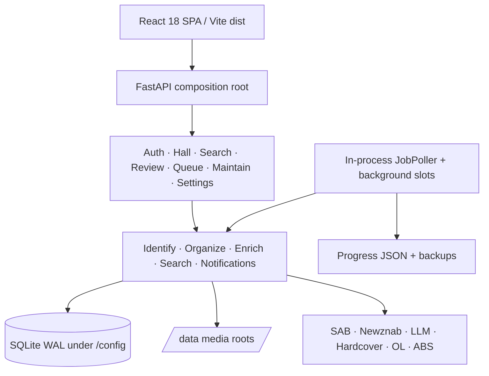
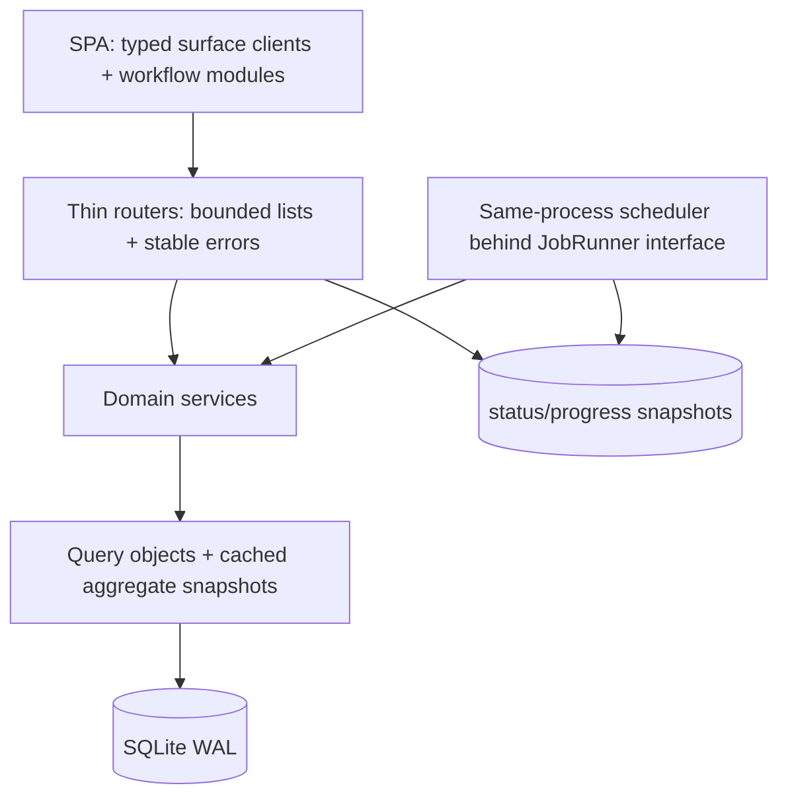

# 08 · Senior Architecture — Librarian — run 2026-11-04

**Reviewed:** Automat `1.0.10 / 480eff0`; single FastAPI process + React SPA + SQLite WAL · **Grade: B**

**Companions:** [Platform map](00_2026-11-04_platform-map.md) · [Growth](05_2026-11-04_growth-content-analytics.md) · [Performance](09_2026-11-04_performance-reliability-cost.md) · [Operations](10_2026-11-04_operations-support.md) · [Backlog](2026-11-04_backlog.csv)

# Part A — Conclusions & findings

## 1. Bottom line

The topology is right-sized: one deployable service, explicit routers, domain services, SQLite WAL, and a prebuilt SPA. The next two years do not require Postgres, a message broker, or microservices. They require finishing boundaries already present: bounded list contracts, non-blocking expensive owner diagnostics, consistent API errors, and smaller Review/Maintain frontend modules (ARCH-002, ARCH-007, ARCH-008). The in-process poller is an acceptable household trade only while its heartbeat, failure isolation, and exit criteria are explicit (ARCH-003). Protect router composition, serializer allowlists, test gates, and `./docker-run.sh` simplicity.

## 2. Key conclusions

1. **The service boundary matches the product.** `librarian.web` owns routers, services, static SPA, and one SQLite database. Optional integrations fail soft. A distributed rewrite would create deployment and backup work without solving current bottlenecks.
2. **Large-catalog pressure is now an API-contract problem.** Hall caps each main rail at 18 (`librarian/web/routers/hall.py:45-68`) and Sorting defaults to 25 with cursor/reason filters (`librarian/web/routers/review.py:31-48`), which are good boundaries. The confirmed shelf-health timeout shows other aggregate endpoints still compute synchronously across ~10.8k books (ARCH-002).
3. **The poller is intentionally more than one loop.** `JobPoller` tracks scheduled steps, separates wanted work, and records per-step last run/error (`librarian/poller.py:198-281,319-368`). It is still one process and therefore one restart/failure domain (ARCH-003).
4. **Frontend complexity is concentrated in owner workflows.** `MaintainPage.jsx` owns dozens of state variables and several 400/700ms poll loops (`frontend/src/pages/MaintainPage.jsx:110-207,383-539`). Review and Maintain should be split by workflow, not rewritten in another framework (ARCH-008).
5. **JavaScript typing debt is real but not urgent enough for a rewrite.** The SPA is React 18/Vite 5 JavaScript with strong Vitest/Testing Library/Playwright/axe gates. TypeScript for new contracts and extracted modules is proportionate; repo-wide conversion is not (ARCH-004).
6. **Error translation has a seam but not one public contract.** Review routes use `http_errors()` around service calls, while other routers raise route-local `HTTPException(detail=...)` (`review.py:50-54,153-165`; `hall.py:98-149`). New work should converge on `{code,message,fields?,retryable?}` without breaking all clients at once (ARCH-007).
7. **The deploy path is a strength, not missing sophistication.** Automat builds from the synced kit with `./docker-run.sh`; Hub remains deferred (`docs/ops/AUTOMAT.md:130-149`). Architecture must not invent a second release topology.

## 3. Foundations challenged

| Assumption | Evidence for | Evidence against | Verdict | Cost | Rationale |
|---|---|---|---|---|---|
| One process | Simple deploy; threads isolate jobs | Restart stops API and poller | Keep with kill criterion | XL | Split only after measured contention or repeated silent death. |
| SQLite WAL | Household scale; online backup; single writer model | ~10.8k books expose query/aggregate cost | Keep | XL | Index/query discipline is the current fix, not a new database. |
| Synchronous FastAPI handlers | Simple DB calls | Shelf-health exceeded live timeout | Change expensive diagnostics | M | Cache or background only proven hot paths. |
| React/Vite JavaScript | Small dependency set; testing triad | Refactors lack static contracts | Gradual TS | L | New/extracted modules typed; no rewrite. |
| In-process poller | Step isolation and status exist | Single failure domain | Keep conditionally | L | See ARCH-003 kill criterion; BD linkage is strategic, not an invented CSV ID. |
| Host-build deployment | Current authoritative path | No registry rollback | Keep now | M | Hub is explicitly deferred; improve restore/version proof first. |
| One API shape can evolve ad hoc | Fast local changes | UI recovery must parse strings | Change incrementally | M | Shared errors for new/touched routes. |

## 4. If we built it today

We would still ship one container and one SQLite database. The backend would be four explicit layers: composition root; thin routers; domain services; repositories/query objects. Expensive aggregates would produce cached snapshots with `generated_at`, `stale`, and refresh status. Every list endpoint would have limit/cursor/total-or-has-more semantics. The frontend would retain React/Vite but use typed surface clients and workflow hooks; owner pages would compose cards instead of owning every poll loop.

The gap is evolutionary. Router extraction, service modules, background job slots, progress JSON, and cursor Review already exist. Close it through bounded slices. Django/Next/Postgres/Celery alternatives were rejected: each replaces working operational knowledge while leaving endpoint cost and owner-page coupling intact.

## 5. Findings by surface

**Public.** Health is deliberately shallow; owner status contains version/revision/backup/poller state (`librarian/web/status.py:53-76`). Public app architecture is appropriately small. **Grade: B+.**

**Consumer.** Hall rails are capped and serializer boundaries are explicit; Browse/Search need the same discipline at 10k+ scale. **Grade: B+.** IDs: ARCH-002.

**Owner.** Review is cursor-paged, but Maintain combines many diagnostics and workflows; shelf-health blocks synchronously. **Grade: C+.** IDs: ARCH-002, ARCH-008.

**Admin/Ops.** Poller steps, backup, progress files, and router composition are solid. Error contracts and single-process recovery are the gaps. **Grade: B.** IDs: ARCH-003, ARCH-007.

## 6. Findings by theme

**Boundaries:** best—explicit router registrars; worst—large owner pages. **Data/API:** best—Hall 18 and Review 25/cursor; worst—synchronous shelf-health aggregation. **Jobs:** best—per-step last error and persisted progress; worst—single process. **Quality:** best—70% coverage floor plus UI triad; worst—mypy allowlist excludes web/database hot paths (`pyproject.toml:90-111`). **Technology:** keep FastAPI, React, Vite, SQLite; spend effort on contracts.

## 7. Stop doing

- Stop adding unbounded arrays or synchronous catalog-wide diagnostics (ARCH-002).
- Stop adding state/poll loops directly to `MaintainPage.jsx` (ARCH-008).
- Stop exposing new error meanings only as prose strings (ARCH-007).
- Do not split poller/container/database without a kill criterion (ARCH-003).
- Do not launch a TypeScript rewrite; type new seams (ARCH-004).
- Do not describe Hub pull as the current Librarian deploy path.

## 8. Strengths worth protecting

- Explicit route registration and role checks (`hall.py:39-46`; `review.py:22-40`).
- Hall and Review default bounds (`hall.py:48-51`; `review.py:31-48`).
- Per-step poller scheduling/error isolation (`poller.py:259-368`).
- Persisted background progress and stale-heartbeat recovery (`maintain.py:191-249,409-476`).
- Public serializer allowlists and the Testing Triad.
- One authoritative `./docker-run.sh` deployment.

## 9. Risks of inaction

The next 10k books will not break SQLite; they will amplify every accidental full scan and payload. Maintain will become a page owners avoid because one card delays the whole experience. Review/Maintain changes will grow conflict-prone and under-tested. A poller death may remain visible only after work stops moving. Ad hoc errors will make the frontend branch on copy and turn copy edits into regressions.

## 10. Recommended direction

**Now:** cache/async shelf health, verify indexes/query plans, and preserve page bounds (ARCH-002). **Next:** standardize errors on touched routes and extract Maintain/Review workflow hooks/components (ARCH-007, ARCH-008). Add TypeScript at those new seams (ARCH-004). **Later:** evaluate poller separation only against the ARCH-003 kill criterion.

Ninety-day success: Hall p95 <2s on LAN; shelf health returns cached data <2s; no initial owner list exceeds 100 records; two owner workflow modules are extracted with tests; new error responses carry stable codes.

## 11. Scorecard

| Surface | Boundaries | Data/API | Jobs | Tests | DX | Overall |
|---|---:|---:|---:|---:|---:|---:|
| Public | 4 | 4 | 4 | 4 | 4 | 4 |
| Consumer | 4 | 4 | 3 | 4 | 3 | 4 |
| Owner | 3 | 3 | 4 | 3 | 2 | 3 |
| Admin/Ops | 4 | 3 | 3 | 4 | 3 | 4 |

## Current-state architecture

## Target-state architecture

Migration: preserve topology; first bound/cache; then extract UI/service seams; only then consider a process split if the kill criterion fires.

# Part B — Detailed findings

## 12. Scope & method

Read the [platform map](00_2026-11-04_platform-map.md), current review/backlog, HELP, Automat runbook, package configs, and indexed Hall/Review/Maintain/poller/status/frontend source. Live facts and confirmed Maintain timeout came from run ground truth. No query plans, full test suite, bundle build, or restore were run.

## 13. Strengths

### ARCH-001: Protect router and service composition

| Field | Value |
|---|---|
| Type | Strength |
| Surface | Cross-cutting |
| Persona(s) | Maintainer |
| Category | Structure |
| Severity | High |
| Impact | 4 |
| Effort | XS |
| Confidence | Confirmed |
| Priority score | 12 |
| Verdict | Protect |
| Dependencies | ARCH-007 |
| Labels | routers, services |

**Evidence:** `librarian/web/routers/hall.py:39-46`; `librarian/web/routers/review.py:22-48`; `librarian/web/app.py:53`.

**Current state:** Composition root injects shared dependencies into feature registrars. **Root cause:** deliberate extraction from app setup.

**Recommendation:** New endpoints belong in existing/new router modules and delegate business work to services.

**Rationale:** This is enough modularity for one service. A framework rewrite is cost without user value.

**User story:** As a maintainer, I want a route’s owner obvious so changes stay reviewable.

**Acceptance criteria:** [ ] No feature handler added directly to composition root. [ ] role check remains route-visible.

**Success metric:** Feature PRs touch one router and one service.

**Validation:** Route map review.

### ARCH-005: Protect the quality gates

| Field | Value |
|---|---|
| Type | Strength |
| Surface | Cross-cutting |
| Persona(s) | Maintainer |
| Category | Testing |
| Severity | High |
| Impact | 4 |
| Effort | XS |
| Confidence | Confirmed |
| Priority score | 12 |
| Verdict | Protect |
| Dependencies | — |
| Labels | pytest, vitest, playwright, axe |

**Evidence:** `pyproject.toml:51-56`; `frontend/package.json:6-17`; `AGENTS.md` testing commands.

**Current state:** Backend coverage floor 70%; Vitest, Playwright :8794, and axe are defined. **Root cause:** testing is a release contract.

**Recommendation:** Keep all gates; add targeted component coverage when ARCH-008 splits modules.

**Rationale:** Tests compensate for gradual typing. Weakening them to speed refactors is backward.

**User story:** As a maintainer, I want boundaries protected by behavior tests.

**Acceptance criteria:** [ ] Coverage ≥70%. [ ] owner flow changes get unit + e2e evidence.

**Success metric:** Zero waived release gates.

**Validation:** CI commands.

### ARCH-006: Protect host-build deployment simplicity

| Field | Value |
|---|---|
| Type | Strength |
| Surface | Admin |
| Persona(s) | Maintainer |
| Category | Deployment |
| Severity | Medium |
| Impact | 4 |
| Effort | XS |
| Confidence | Confirmed |
| Priority score | 8 |
| Verdict | Protect |
| Dependencies | — |
| Labels | docker-run, automat |

**Evidence:** `docs/ops/AUTOMAT.md:130-149`.

**Current state:** Synced kit builds and runs with one host command; Hub is explicitly deferred. **Root cause:** single-maintainer LAN deployment.

**Recommendation:** Keep one path until Hub publishing is deliberately adopted.

**Rationale:** A second half-supported path creates drift. Improve verification/rollback first.

**User story:** As a maintainer, I want one authoritative deployment procedure.

**Acceptance criteria:** [ ] Docs name `./docker-run.sh`. [ ] sibling ports untouched.

**Success metric:** Version stamp matches intended rev after deploy.

**Validation:** Health plus `/app/.build-info`.

## 14. Weaknesses

### ARCH-002: Bound and profile large-catalog paths

| Field | Value |
|---|---|
| Type | Weakness |
| Surface | Cross-cutting |
| Persona(s) | All |
| Category | Data/API |
| Severity | High |
| Impact | 4 |
| Effort | M |
| Confidence | Confirmed |
| Priority score | 4.0 |
| Verdict | Fix |
| Dependencies | PERF-008 |
| Labels | sqlite, pagination |

**Evidence:** ~10.8k books and confirmed shelf-health timeout; Hall caps 18 (`hall.py:45-68`); Review defaults 25/cursor (`review.py:31-48`); shelf health synchronously calls permission and multiple counts (`maintain.py:116-130`).

**Current state:** Core lists are bounded; heavy aggregates are not uniformly snapshot-based. **Root cause:** diagnostic endpoints grew as direct compositions of scans/counts.

**Recommendation:** capture query plans/indexes; cache shelf-health snapshot; enforce `limit≤100`; return `next_cursor/has_more`; add endpoint budgets.

**Rationale:** Fix proven hot paths before changing storage. Now because timeout is confirmed.

**User story:** As an owner, I want large shelves to remain responsive.

**Acceptance criteria:** [ ] Hall p95 <2s. [ ] Review first page <1s. [ ] shelf-health cached <2s. [ ] no initial list >100.

**Success metric:** SLOs hold at 10.8k works.

**Validation:** LAN timing and `EXPLAIN QUERY PLAN`.

### ARCH-003: Keep the poller only behind a kill criterion

| Field | Value |
|---|---|
| Type | Weakness |
| Surface | Owner |
| Persona(s) | Owner |
| Category | Reliability |
| Severity | Medium |
| Impact | 3 |
| Effort | L |
| Confidence | Confirmed |
| Priority score | 1.6 |
| Verdict | Investigate |
| Dependencies | strategic process decision |
| Labels | poller, resilience |

**Evidence:** `librarian/poller.py:198-281,319-368`; readiness requires SQLite and a live poller (`librarian/web/status.py:67-76`).

**Current state:** Steps isolate errors and expose status, but API and jobs share process/restart fate. **Root cause:** deployment simplicity.

**Recommendation:** Keep in-process now. Split only if any two occur in 30 days: poller dead >5 minutes twice; p95 API >2s during jobs; one job crash restarts service; job recovery requires manual DB work.

**Rationale:** A worker now adds supervision and SQLite coordination. The criterion prevents indefinite deference. Any eventual BD linkage belongs in synthesis; do not invent a new CSV BD ID here.

**User story:** As an owner, I want jobs to fail visibly without destabilizing reading.

**Acceptance criteria:** [ ] heartbeat age and last error visible. [ ] alert on dead/stale. [ ] kill criterion documented.

**Success metric:** No silent poller death.

**Validation:** fault injection in test environment.

### ARCH-004: Type new frontend seams without rewriting

| Field | Value |
|---|---|
| Type | Weakness |
| Surface | Cross-cutting |
| Persona(s) | Maintainer |
| Category | DX |
| Severity | Low |
| Impact | 2 |
| Effort | XL |
| Confidence | Likely |
| Priority score | 0.2 |
| Verdict | Rethink |
| Dependencies | ARCH-008 |
| Labels | typescript |

**Evidence:** `frontend/package.json:18-41` has React/Vite/Vitest but no TypeScript; API payloads are hand-shaped in `frontend/src/api.js`.

**Current state:** Runtime tests carry contract risk. **Root cause:** JavaScript-first SPA.

**Recommendation:** `.ts/.tsx` for new clients/hooks and extracted workflow modules; JSDoc/Zod-like validation where conversion is not economical.

**Rationale:** Gradual typing targets changing seams. Rewrite cost is not justified; later horizon is correct.

**User story:** As a maintainer, I want payload mismatches caught near changed modules.

**Acceptance criteria:** [ ] New extracted modules typed. [ ] no big-bang conversion.

**Success metric:** New owner modules are typed.

**Validation:** build/typecheck.

### ARCH-008: Split owner workflow hotspots

| Field | Value |
|---|---|
| Type | Weakness |
| Surface | Owner |
| Persona(s) | Maintainer, owner |
| Category | Structure |
| Severity | Medium |
| Impact | 3 |
| Effort | M |
| Confidence | Confirmed |
| Priority score | 2.0 |
| Verdict | Fix |
| Dependencies | ARCH-004 |
| Labels | maintain, review |

**Evidence:** `frontend/src/pages/MaintainPage.jsx:110-207,209-375,383-539` owns many cards, waves, and poll loops; codegraph reports sparse direct component coverage.

**Current state:** One page coordinates unrelated jobs and diagnostics. **Root cause:** incremental feature accretion.

**Recommendation:** extract `useMaintainOverview`, `useProgressJob`, ShelfHealthCard, CatalogCleanupCard, and similar Review desk hooks/cards. Preserve route and visuals.

**Rationale:** Smaller seams improve tests and typing without redesign. Next, after hot endpoint stabilization.

**User story:** As an owner, I want one card failure not to blank the desk.

**Acceptance criteria:** [ ] independent error/loading boundaries. [ ] shared visibility-aware poll hook. [ ] component tests.

**Success metric:** Desk changes touch bounded modules.

**Validation:** Vitest and targeted Playwright.

## 15. Opportunities

### ARCH-007: Establish a stable API error envelope

| Field | Value |
|---|---|
| Type | Opportunity |
| Surface | Cross-cutting |
| Persona(s) | Client developer, user recovering from error |
| Category | API |
| Severity | Medium |
| Impact | 3 |
| Effort | M |
| Confidence | Likely |
| Priority score | 1.6 |
| Verdict | Fix |
| Dependencies | — |
| Labels | errors |

**Evidence:** `review.py:50-54,153-165` uses `http_errors`; `hall.py:98-149` raises local detail strings.

**Current state:** Status codes are usable; machine meaning is inconsistent. **Root cause:** router-by-router evolution.

**Recommendation:** new/touched routes return `{"error":{"code","message","fields","retryable"}}`; retain old `detail` through a compatibility handler for one release.

**Rationale:** Stable codes decouple copy from behavior. Incremental adoption avoids a risky flag day; do next alongside module work.

**User story:** As a client, I want stable error codes so recovery survives copy edits.

**Acceptance criteria:** [ ] sample auth/review/maintain errors share envelope. [ ] old clients still receive readable message.

**Success metric:** No frontend branch on full prose.

**Validation:** contract tests.

## 16. Remediation plan

| Horizon | ID | Work | Effort | Owner | Dependencies |
|---|---|---|---|---|---|
| Now | ARCH-002 | Profile, index, cache shelf health | M | BE/SRE | — |
| Next | ARCH-007 | Shared error envelope on touched routes | M | BE | — |
| Next | ARCH-008 | Extract owner workflow modules | M | FE | ARCH-002 |
| Later | ARCH-004 | Continue gradual typing | L | FE | ARCH-008 |
| Later | ARCH-003 | Re-evaluate process split only if criterion fires | L | Architecture/Ops | metrics |

## 17. Quick wins

Document endpoint bounds, clamp Review limit to 100, add `generated_at/stale` to shelf-health, and reuse one visibility-aware poll hook.

## 18. Open questions

1. Which shelf-health sub-operation consumed the confirmed timeout?
2. Do Browse/Search query plans use covering indexes at 10.8k works?
3. Has the poller ever failed while API health stayed green?
4. Which Maintain/Review extraction yields the highest test value first?

## Self-check

- [x] Full Part A, four surfaces, current and target Mermaid diagrams.
- [x] ARCH-002/003/004/007/008 preserved with full ticket fields.
- [x] ARCH-003 kill criterion stated without inventing an orphan BD ID.
- [x] Alternatives, phased migration, and why now/later included.
